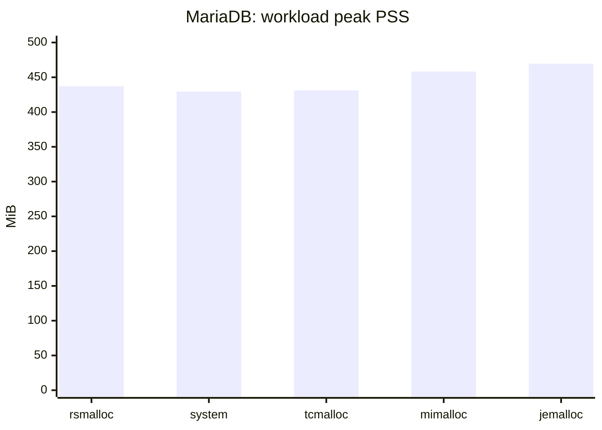
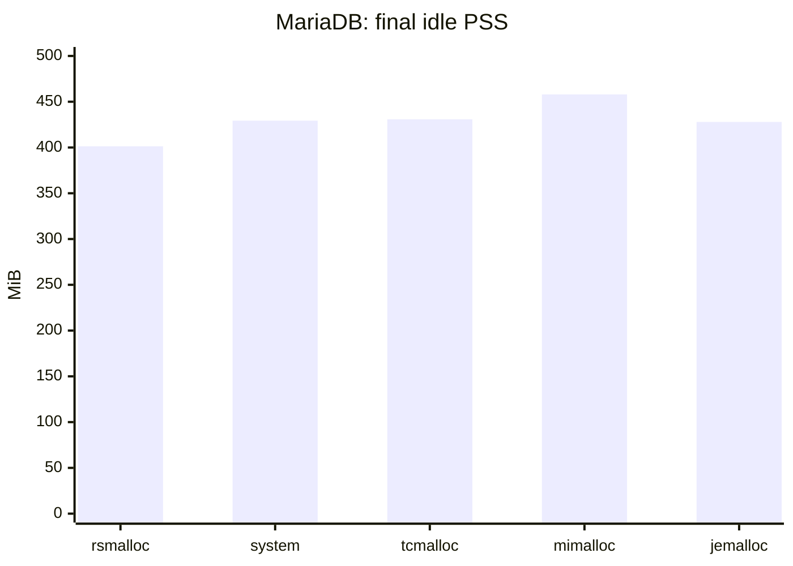

# MariaDB benchmark results

[Detailed measurements](mariadb_results_detailed.md) · [Harness and reproduction instructions](mariadb/README.md)

MariaDB/sysbench snapshot collected on **2026-10-23**, comparing five allocator configurations in a multithreaded database server. There is **one completed run per allocator**, not a repeated-run median. Small throughput differences should not be treated as established allocator speedups.

## Workload and environment

- MariaDB **13.0.2**, Arch Linux build; sysbench **1.0.20-1472a05**.
- CachyOS Linux **7.2.9-2-cachyos**, x86-64.
- Storage: **SanDisk SSD Plus 1TB A3N**.
- Eight tables of 250,000 rows each; **32 client threads**.
- **256 MiB InnoDB buffer pool**.
- **30 s read-only warmup**, **60 s read/write OLTP**, then **15 s idle**.
- Requested memory sampling interval: **0.20 s**; actual intervals include sampling overhead.
- Each variant uses the harness's isolated database snapshot and private Unix socket. Alternative allocators are loaded into the server with `LD_PRELOAD`.

These environment records do not identify the CPU, RAM capacity, compiler, RSMalloc commit/build features, exact allocator package versions, or THP policy. Do not substitute metadata from the separate synthetic benchmark snapshot. Library names and recorded settings are preserved in the [detailed report](mariadb_results_detailed.md).

## Results at a glance

Memory values below are **MiB** (recorded KiB divided by 1,024). Peak PSS/RSS are sampled maxima **during the read/write workload**. Final idle PSS is the **last idle sample**, not the maximum over the idle phase. TPS and latency come from the final sysbench read/write report.

| Allocator | Transactions/s ↑ | Mean latency (ms) ↓ | p95 latency (ms) ↓ | Workload peak RSS (MiB) ↓ | Workload peak PSS (MiB) ↓ | Final idle PSS (MiB) ↓ |
| --- | ---: | ---: | ---: | ---: | ---: | ---: |
| RSMalloc | **7,746.64** | **4.13** | **6.09** | 447.08 | 437.05 | **401.33** |
| System default | 7,675.65 | 4.17 | 6.32 | **439.45** | **429.51** | 429.29 |
| tcmalloc | 7,708.23 | 4.15 | 6.21 | 441.32 | 431.16 | 430.82 |
| mimalloc | 7,717.39 | 4.15 | **6.09** | 468.31 | 458.21 | 458.01 |
| jemalloc | 7,651.20 | 4.18 | 6.32 | 479.54 | 469.58 | 427.88 |

Bold marks the best recorded value, including ties; it does not establish statistical significance.

### RSMalloc relative to each alternative

Percentages are `(RSMalloc / alternative - 1) × 100`, calculated before display rounding. Positive throughput is higher; negative memory is lower.

| Alternative | Transactions/s difference | Workload peak PSS difference | Final idle PSS difference |
| --- | ---: | ---: | ---: |
| System default | +0.92% | +1.76% | −6.51% |
| tcmalloc | +0.50% | +1.37% | −6.84% |
| mimalloc | +0.38% | −4.62% | −12.38% |
| jemalloc | +1.25% | −6.93% | −6.20% |

## Memory profile

RSMalloc's PSS falls from a workload peak of **437.05 MiB** to **401.33 MiB** at the final idle sample, a **35.72 MiB** decrease. Jemalloc shows a larger peak-to-final decrease (**41.70 MiB**) but ends above RSMalloc. The system-default, tcmalloc, and mimalloc runs change little by this measure.

This is whole-process memory, including engine caches and query state—not allocator-only overhead. A peak-to-final decrease is not a direct measurement of bytes reclaimed by the allocator.

## Interpretation and limits

- RSMalloc records the highest TPS here, but the entire throughput spread is small. One run per variant cannot separate these differences from run-order, scheduler, storage, or random-input variation.
- System default has the lowest workload peak PSS; RSMalloc has the lowest final idle PSS. There is no single winner for every memory phase.
- All read/write runs report **4,626–4,785 ignored SQL errors**, and zero reconnects. The supplied logs do not identify the ignored error codes. Do not describe this as error-free traffic or attribute the errors to an allocator without further evidence. Read-only warmups report zero ignored errors.
- Final aggregate p95 latency is available; **p99 is not recorded**. The reported maximum is not a substitute for p99.
- Raw memory samples report **zero swap throughout every run**. The supplied summary CSVs leave peak swap blank; the detailed report derives that value from the raw samples rather than treating a blank as a measurement.
- Virtual-size measurements are excluded because the recorded values appear anomalous and have not been validated. RSS, PSS, and private/anonymous measurements are retained.
- Requested allocator libraries are present in each preloaded server's recorded mappings. This supports successful library loading, but is not proof that every server allocation was interposed.
- All five server logs contain a clean shutdown and no `[Warning]` or `[ERROR]` entries. This is a benchmark snapshot, not a correctness or production-readiness certification.

For this workload, the useful signal is **competitive observed throughput with lower end-of-idle memory**, while retaining the workload-peak tradeoff against system default and tcmalloc. Repeat runs in rotated order before treating small differences as stable advantages.
