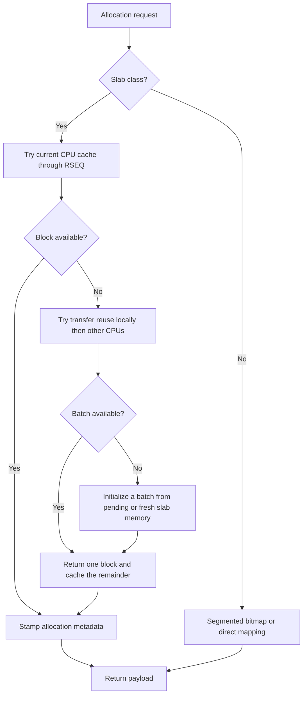

# How the Allocator Works

This chapter explains the mechanisms behind the [workload guidance](workload-fit.md). It describes the current alpha implementation, not a stable internal ABI.

## Detailed architecture reading map

The overview below is the short version. The following chapters follow the current source's structures, algorithms, publication rules, and failure paths:

| Chapter | Questions answered | Primary implementation |
| --- | --- | --- |
| [Frontends and bootstrap](architecture-bootstrap.md) | How do Rust and C calls converge? Which settings initialize first? What can fail before serving requests? | `src/frontend/`, `src/backend/bootstrap.rs`, `src/inner/preload/` |
| [RSEQ and CPU-local caches](architecture-rseq.md) | What is in each cache? Which assembly store commits? What happens on migration, empty lists, and overflow? | `src/rseq_core/slab_cache.rs`, `src/rseq_core/slab_cache/rseq_asm.rs`, `src/rseq_core/rseq_offsets.rs` |
| [Transfer reuse](architecture-transfer.md) | How are batches published, detached, hinted, stolen, and partitioned for trim? What does tagged CAS not prove? | `src/rseq_core/slab_cache/transfer.rs`, `src/rseq_core/slab_cache/reclaim.rs` |
| [Refill and deferred initialization](architecture-refill.md) | What are the actual predictor equations? Who owns an unfinished span? How does queue failure affect capacity? | `src/core_prim/predictor.rs`, `src/rseq_core/bulk_fill.rs`, `src/rseq_core/pending_queue.rs` |
| [Backing memory](architecture-backing-memory.md) | How do arenas reserve ranges and bitmap regions claim orders? When are direct mappings used? | `src/backend/page_allocator.rs`, `src/big_allocations/` |
| [Ownership and resizing](architecture-ownership.md) | What do headers, aligned prefixes, radix bits, and exact metadata mean? How do free, calloc, realloc, and fork interact? | `src/inner/`, `src/internals/`, `src/core_prim/fork.rs` |
| [Reclamation and relief](architecture-reclamation.md) | Which pages qualify, how are scans scheduled, what is excluded, and what does pressure relief measure? | `src/backend/background_thread.rs`, slab reclaim and bitmap trim code |
| [Concurrency and observations](architecture-concurrency.md) | Which state is authoritative? What are the current race, accounting, progress, and telemetry limits? | Cross-subsystem synchronization and diagnostic frontends |

Each detailed chapter cites source paths and symbols. Numeric layouts and policy equations are implementation snapshots and can change. The architecture explanation is not an audit or a guarantee of production safety.

## CPU-local is not thread-local

Each CPU has slab caches indexed by size class. The thread currently executing on that CPU accesses those caches through Linux restartable sequences (RSEQ). RSMalloc keeps refill metadata and batching state per CPU too; it still depends on libc's thread-local RSEQ registration.

A thread does not own a private small-object heap. A free normally feeds the **current CPU**, which may differ from the allocating CPU. Overflow and refill exchange blocks through transfer caches. This removes the need to abandon a thread-owned heap when a thread exits, but introduces shared-cache traffic when demand and frees are spread unevenly.

RSEQ protects a short critical section against migration or interruption before its commit. It is not a transaction that rolls back arbitrary writes, and it does not make the entire allocator lock-free.

## The slab allocation lifecycle

Requests represented by the 34 slab classes, through 2 MiB, use the slab path. Alignment and metadata overhead affect the storage needed; do not use nominal payload size alone to predict every aligned request's route.

On a cache hit, the allocator pops a linked-list head. The head store is the RSEQ commit; a locked usage decrement follows outside the critical section. On an empty list it returns no block without decrementing usage. Abort handling signals recovery/retry rather than returning a partially committed object.

Free performs metadata classification, stamps the block's lifetime and freed state, then attempts a CPU-cache push. Full caches or recovery paths use transfer storage. [Ownership checks](security.md#ownership-first-validation) are optional upfront checks: the default free path reads metadata first and requires valid live RSMalloc pointers.

**Important cost:** a successful local slab operation still includes a locked usage update. “No cache mutex” does not mean “no atomic instruction,” “no memory traffic,” or “minimal possible instruction count.”

## Refill and transfer reuse

Transfer caches hold initialized blocks for reuse. Search prefers the local NUMA node before remote nodes; hints guide search but do not prove that blocks exist. Transfer and overflow-queue heads use ABA-resistant tagged atomic state. Heavy simultaneous exchange can still contend on those heads and pay dependent linked-list loads.

Two policies serve different jobs:

- **Transfer batching** chooses how many already initialized blocks to request. By default it targets one quarter of the supplying list's sampled inventory, clamped to class limits, and closes one quarter of the gap at each update.
- **Bulk-fill batching** controls fresh-block initialization independently. Per-CPU/class pending spans allow later refills to continue initialization; collisions and overflow use a shared queue.

`confidence-predictor` changes transfer sizing. `experimental-predictive-demand` adds refill-time occupancy feedback. Neither is default, neither removes cache-hit costs, and either can regress performance or memory use. Advisory prediction affects policy, not correctness.

## Backing memory and large objects

The slab page backend reserves ranges from NUMA-preferred bump arenas. The default minimum arena data size is 256 MiB. Mapped capacity is not immediately equivalent to resident memory: touching pages and kernel THP policy determine residency. Arena growth and metadata operations can use locks.

Large requests normally try a segmented-bitmap backend with 4, 8, 16, 32, or 64 MiB blocks. Its regions contain 64 MiB segments. Eligibility is based on **adjusted total size**, including the header and page/THP adjustment, and is limited to 64 MiB. A 64 MiB payload therefore exceeds that limit; smaller order-boundary payloads can also need the next order.

If reuse is disabled, ineligible, or unavailable, allocation falls back to a dedicated mapping. Direct frees unmap that allocation. Bitmap frees instead make slots available for reuse. A sharded, lock-protected metadata map tracks exact large allocations; the ownership radix tracks coarse 4 KiB regions.

Power-of-two rounding, alignment padding, region growth, metadata, and sparse page touching explain why requested bytes, virtual size, and RSS can differ substantially.

## Freeing is not the same as returning RAM

A freed object is no longer yours, even if its pages remain resident. Cached blocks can serve the next allocation without another mapping or page fault.

Background trimming advises eligible cold payload pages away using `madvise`. Slab eligibility depends on class, complete reclaimable pages, and observed lifetimes; small classes without reclaimable payload pages are not covered by this mechanism. Segmented-bitmap trimming uses free-slot ages. Regions can remain virtually reserved after pages are reclaimed.

Manual trimming is best-effort, not a request to empty every cache or meet an RSS deadline. `lazy-page-trim` allows lazy reclamation; memory may remain resident until the kernel needs it. Pressure relief is a separate, opt-in, system-wide policy and is not a cgroup memory limiter.

## NUMA preference has limits

Node-aware reuse and preferred `mbind` policy aim to reduce remote traffic. They do not guarantee physical placement: first touch, migration, kernel policy, CPU restrictions, and cross-thread consumers still matter. The public capability surface reports NUMA support as partial.

Use [diagnostics](diagnostics.md) to distinguish cache hits, refill/exchange work, and mapping activity. Use application measurements to decide whether those mechanisms actually help.

## Current implementation caveats

The source has limits worth retaining alongside the intended design:

- Transfer trimming can leave sampled inventory counters inaccurate even after operations finish; a counter is not exact free-list ownership.
- Pending-queue mapping/publication failure can strand an unfinished extent's remaining refill capacity without failing the already initialized batch.

- Recoverable public allocation errors do not cover every internal failure: mandatory ownership metadata allocation can abort.
- Reports are independently sampled and can allocate or lock; several counter names describe narrower instrumentation than their names suggest.

See [concurrency and observation limits](architecture-concurrency.md) for the precise distinctions and source references. These caveats are documented, not repaired, by this book update.
