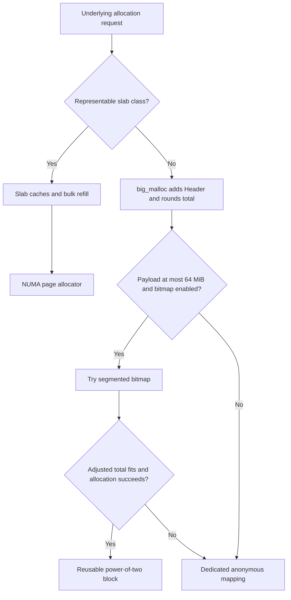
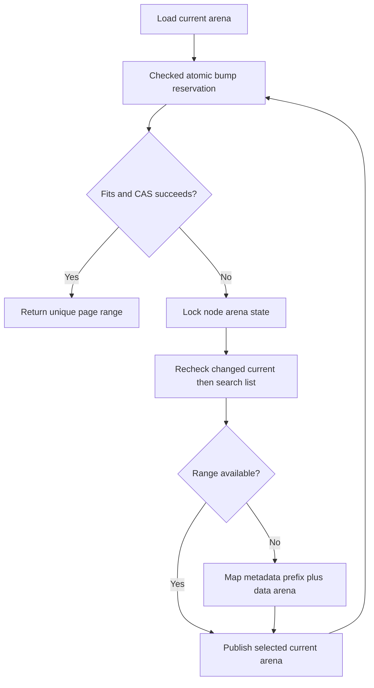

# Backing Memory and Large Allocations

This chapter follows the current implementation, not a stable internal ABI.
Backing memory has three distinct lifetimes: arena reservations, reusable bitmap
blocks, and dedicated mappings. They must not be conflated with object lifetime
or resident physical memory.

Source citations below use repository-relative paths and symbols, rather than
relative URLs into `src/`: those URLs would not exist in the rendered book.
Bootstrap is mentioned only where it establishes backend inputs.

## Routing and ownership

The slab size table ends at a 2 MiB payload. `match_size_class` returns `None`
above that bound; large allocation then uses `big_malloc`. Alignment wrappers can
increase the underlying request, so the application payload alone is not always
the routing input.

Source: `src/utility.rs` — `SIZE_CLASSES`, `match_size_class`;
`src/big_allocations/big_allocation.rs` — `big_malloc`;
`src/rseq_core/bulk_fill.rs` — `alloc_metadata`.

| Backing owner | Allocation unit | What free does |
| --- | --- | --- |
| Page allocator | Page-rounded bump reservation | No page-allocator free operation |
| Segmented bitmap | 4–64 MiB block inside a segment | Clears occupied slots for reuse |
| Direct large mapping | Adjusted header-plus-payload extent | Clears radix ownership and calls `munmap` |

The ownership radix and exact large-allocation map serve different purposes.
`RADIX` records coarse address ownership; `BIG_MAP` records the canonical payload
pointer and allocation details. A radix hit is not proof of an exact live object.

## NUMA page arenas

`PageAllocator` lazily constructs a table of cache-line-aligned `NodeArena`s.
Initialization uses an anonymous private read/write mapping and `Once`; the
node count is at least one. Bootstrap supplies the slab topology's `nranges`.
If the table mapping fails, allocation finds no initialized table and returns
`None`.

Each node has a current-arena atomic pointer and a spin-locked arena list.
Each `PageArena` contains linked-list pointers, data bounds, and an atomic bump
cursor. Its metadata occupies a page-rounded prefix of the arena mapping;
callers receive data after that prefix.

`alloc` rounds `max(size, 1)` to 4096 bytes with checked arithmetic. An explicit
node is accepted; otherwise the current RSEQ CPU is translated through
`SLAB_CACHE.node_for_cpu`. Out-of-table node IDs fall back to node zero.

Source: `src/backend/page_allocator.rs` — `PageAllocator::init`, `alloc`,
`PageArena`, `NodeArena`; `src/backend/bootstrap.rs` — `main_bootstrap`.

### Atomic bump fast path

`alloc_inner` loads `node.current` with acquire ordering. `allocate_from_arena`
loads the cursor, checks `start + size <= end`, and retries a weak CAS to reserve
`[start, next)`. A successful CAS uses release ordering; failed CAS observations
replace the expected cursor. Competing callers cannot reserve the same bytes.

This is not an object free list: freeing objects never rewinds the bump cursor.
Fast-path cost includes atomic contention when callers share a node's current
arena, even though there is no fast-path arena-list mutex.

On exhaustion, `alloc_slow` takes the node lock, rechecks whether another caller
installed a new current arena, searches retained arenas, and finally maps a new
one. Successful search or growth publishes the current pointer with release
ordering.

Source: `src/backend/page_allocator.rs` — `alloc_inner`, `alloc_slow`,
`allocate_search`, `allocate_from_arena`.

### Growth, retirement, and physical placement

New data capacity is `max(requested, ARENA_SIZE)`, rounded to a page; the
page-rounded `PageArena` prefix is additional. `ARENA_SIZE` starts at 256 MiB,
and bootstrap clamps configured values to `MIN_ARENA_SIZE` (256 KiB).
Mapping attempts use `MAX_REFILL_RETRIES.max(1)`; exhaustion returns `None`.

An arena with less than `MIN_REFILL_BYTES` remaining is removed from the search
list. `remove_arena` atomically advances its cursor to `end`, unlinks it, and
conditionally changes the current pointer. **Removal does not unmap it.**
Existing allocations and metadata addresses therefore remain valid; this is
retirement from allocation search, not reclamation of the arena reservation.

`try_grow_inplace` locks the node list and finds the containing arena. The range
must be page-aligned, remain within that arena, and end exactly at the current
bump cursor. Its CAS extends only that last reservation. Another allocation
advancing the cursor defeats growth. A retired arena is no longer searchable.

Slab `small_realloc` uses this opportunity only for validated single-block
refill geometry and updates span bounds, class, radix range, and cached-byte
accounting on success.

Source: `src/backend/page_allocator.rs` — `new_arena_locked`, `maybe_remove`,
`remove_arena`, `try_grow_inplace`; `src/utility.rs` — `MIN_REFILL_BYTES`;
`src/inner/realloc.rs` — `small_realloc`.

Arena mappings call `NumaBind.prefer_node`. This wraps Linux `mbind` with
`MPOL_PREFERRED`; failure is ignored by these callers. The binder supports a
single machine-word node mask and rejects IDs at or above `usize::BITS`.
Preference is not strict binding, migration, or guaranteed physical placement.
Anonymous mapping reserves virtual space; first touch and kernel policy affect
which physical pages are actually populated.

Source: `src/internals/binder.rs` — `mbind_node`, `NumaBind::prefer_node`.

## Segmented bitmap geometry

The bitmap replaces explicit buddy split/coalesce lists with aligned bit runs.
Its public orders are byte exponents 22 through 26; segment-local orders are
indices zero through four.

| Byte order | Block bytes | Slots occupied | Permitted local starts |
| --- | --- | --- | --- |
| 22 | 4 MiB | 1 | Any slot |
| 23 | 8 MiB | 2 | Multiples of 2 |
| 24 | 16 MiB | 4 | Multiples of 4 |
| 25 | 32 MiB | 8 | Multiples of 8 |
| 26 | 64 MiB | 16 | Slot 0 |

Every segment has sixteen 4 MiB slots, totaling 64 MiB. `candidates` folds a
free-bit mask with shifts and an alignment mask; `slot_mask` selects the run.
Alignment is relative to the segment base, not a promise that an anonymous
mapping's base is aligned to the block's size in absolute address space.

Source: `src/big_allocations/segmented_bitmap.rs` — order constants;
`src/big_allocations/segmented_bitmap/segment.rs` — `SLOTS`, `SLOT_BYTES`,
`SEGMENT_BYTES`, `candidates`, `slot_mask`.

### Three planes in one atomic word

A segment's hot cache-line-aligned structure holds its base and `AtomicU64`.
Sixteen per-slot `AtomicU32` free timestamps live outside that hot structure.
The word contains three meaningful 16-bit planes:

| Bits | Meaning |
| --- | --- |
| 0–15 | Occupied by an allocation or temporarily claimed by trimming |
| 16–31 | Dirty: needs advice before being classified as reclaimed |
| 32–47 | History: has ever been allocated |
| 48–63 | Unused by this implementation |

Allocation atomically sets all three planes for its run. Classification uses
the **previous** word: any dirty slot means `Allocated`, otherwise any history
slot means `Reclaimed`, otherwise `NotAllocated`.
Free writes each slot's free timestamp, then release-clears occupancy only.
Dirty and history remain set. There is no merge operation: adjacent free bits
implicitly become candidates for larger aligned runs.

Trimming temporarily sets occupancy before advising pages; allocation cannot
claim those slots during the syscall. Successful trimming clears dirty and
occupancy, but preserves history. Advice failure clears occupancy only.
History therefore distinguishes never-used space from previously used space;
it does not promise that the payload is currently zero.

Source: `src/big_allocations/segmented_bitmap/segment.rs` — `classify`,
`Segment::alloc`, `free`, `claim_trim`, `finish_trim`.

### Reading bitmap reports

`SegmentedBitmapAllocator::report` snapshots each segment independently. Starting
at its lowest free slot, it chooses the largest aligned power-of-two run that
fits the remaining free bits, records it, clears that mask from its working
copy, and repeats. `free_blocks` (exposed as
`segmented_bitmap_free_blocks_by_order`) is therefore a **disjoint greedy
decomposition**, not a count of every allocation candidate at every order.
A completely free segment contributes one 64 MiB block, not also sixteen 4 MiB
and eight 8 MiB candidates. These are sampled inventory counts, not cumulative
allocation, reuse, or trimming events.

Classification applies to the entire selected run: any dirty slot makes it
`reused`; otherwise any history slot makes it `trimmed`; only an all-never-used
run is `never_allocated`. Derived category byte totals weight each classified
run by its full size. They do not precisely measure dirty-slot bytes or bytes
successfully advised: one dirty slot in an otherwise clean free segment can
classify all 64 MiB as reused.

Reported `used_bytes` is `total_region_bytes - free_bytes`. Temporary trim
occupancy is indistinguishable from allocation occupancy in this snapshot and
therefore contributes to used bytes. Region snapshots are not one globally
atomic view, and used bytes are not exact live requested payload or RSS.

Source: `src/big_allocations/segmented_bitmap.rs` —
`SegmentedBitmapAllocator::report`;
`src/big_allocations/segmented_bitmap/segment.rs` — `classify`, `claim_trim`;
`src/frontend/global_alloc2/debug.rs` — `get_stats`.

### Regions, hints, and expansion

`State` owns per-node region heads and per-node CPU hint lanes. The lane count
is `ncpu.clamp(1, 96)`; CPUs beyond it share lanes modulo that count. Each lane
stores one preferred segment per order. Hints select where to try first, not
whether an allocation is valid or available.

The slow search walks newest-first regions and scans each segment once, starting
at `lane % segment_count`, skipping the already-failed preferred segment.
The initial region size is the configured size rounded up to a power of two,
with a 64 MiB minimum; overflow normalization falls back to one segment.
Only the bootstrap CPU's selected node receives an initial region.

After local search fails, `expand` locks that node's growth lock and rechecks.
It creates a **64 MiB** region, claims a block before publication, then publishes
the region and hint. If creation fails, it searches existing regions on other
active NUMA nodes; it does not grow those remote nodes on this path.
Published regions and segment addresses remain stable; there is no normal
region-deletion path.

Source: `src/big_allocations/segmented_bitmap.rs` — `HintLane`, `Node::alloc`,
`alloc_slow`, `publish`, `init`, `normalize_region_size`, `expand`.

`reserve` selects backing independently from object routing:

- State and region metadata always use `PAGE_ALLOCATOR`.
- Region data smaller than `ARENA_SIZE` also uses the page allocator.
- Region data at least `ARENA_SIZE` uses its own retried anonymous mapping.
- Direct region mappings use NUMA preference only when `state.is_numa` is true.

`create_region` allocates data and metadata separately, initializes segments,
registers the entire data range in `RADIX`, and accounts both extents. Its
metadata-allocation failure branch calls `munmap(data, bytes)`, even when
`reserve` supplied an arena subrange; it is not an arena bump rollback.

Source: `src/big_allocations/segmented_bitmap.rs` — `reserve`, `create_region`.

## Large allocation metadata and direct mappings

`big_malloc` adds `Header::SIZE` with checked arithmetic. The total normally
rounds to 4096 bytes; with runtime THP enabled it rounds to 2 MiB when the
positive remainder is within 64 KiB of that boundary.
The bitmap attempt additionally requires an initialized backend, a payload no
larger than 64 MiB, and an unset relief-disable flag. Its adjusted total must
fit one segment: a **64 MiB payload plus header cannot fit**.

Bitmap success records its power-of-two extent. Otherwise a private anonymous
mapping uses the adjusted total exactly, not the next power of two.
Direct mappings are NUMA-preferred on NUMA systems. Multiples of 2 MiB receive
best-effort huge-page advice when runtime THP is not disabled.

Every large header has `BIG_MAGIC` and class 100. Bitmap headers use `BigAlloc`;
direct headers use `NotAllocated`. `BIG_MAP.insert` keys metadata by the
canonical payload address, storing exact requested `size`, exponent `order`,
`segmented_bitmap_region`, and `aligned`. Despite its name, the nonzero
`segmented_bitmap_region` value is a **Segment pointer**, not a Region pointer.
For direct mappings, `order` is rounded upward and is not their exact length.

`big_free` removes exact metadata first; absence aborts as corruption. Bitmap
free uses the stored segment pointer and order. Direct free recomputes the exact
mapping length from `size + Header::SIZE`, clears the radix registration, and
calls `munmap`. Aligned direct mappings register/clear the whole range;
ordinary direct mappings use `set_single_big`. Alignment wrappers recover the
canonical pointer before this operation.

Source: `src/big_allocations/big_allocation.rs` — `estimate_and_align_2mb`,
`big_malloc`, `big_free`; `src/lib.rs` — `BigAllocMeta`;
`src/inner/free.rs` — `find_original_ptr`.

`BigMetaMap` has 64 cache-line-aligned locked shards, each with 64 chained
buckets. Nodes recycle on removal; fresh chunks contain 64 nodes. Small chunks
prefer arena memory with a direct `PRIVATE | NORESERVE` mapping fallback.
Metadata exhaustion aborts rather than returning an allocation without metadata.
Hashing distributes keys but bucket-chain scans and shard contention still cost.

Source: `src/internals/big_meta_map.rs` — `location`, `insert`, `get`, `replace`,
`remove`, `alloc_chunk`, `map_mem`.

## Resize, zeroing, and THP boundaries

`big_realloc` returns unchanged for requests no larger than recorded size;
that early return does not shrink the mapping or rewrite the size metadata.
Bitmap growth within existing capacity updates requested size. Beyond capacity,
`Segment::grow` can claim only the right adjacent half when the allocation is
aligned as the left half of the larger run. Each successful doubling updates
metadata immediately, even if a later doubling fails.

Direct growth tries `mremap` without `MAYMOVE`; failure falls back to allocate,
copy, and free. Replacement copies at most the recorded old payload size and
preserves the old allocation if replacement allocation fails. Offset-aligned
pointers or increased alignment requirements use `aligned_realloc` instead.
No realloc path here promises zero-filled newly exposed bytes.

Source: `src/inner/realloc.rs` — `big_realloc`, `replace_allocation`,
`aligned_realloc`; `src/big_allocations/segmented_bitmap/segment.rs` — `grow`.

`rs_calloc` explicitly zeros `Allocated`, `Reclaimed`, and `BigAlloc` payloads.
Thus bitmap allocation always gets explicit calloc zeroing, even if its internal
classification reported never-used space. Fresh direct anonymous mappings can
skip writes under `NotAllocated`. `explicit-zero` selects `explicit_bzero`
instead of `write_bytes`; lazy reclamation does not weaken calloc semantics.

Source: `src/inner/calloc.rs` — `calloc_zero`, `rs_calloc`, `zero`.

For **page arena mappings**, huge-page feature guards are mutually exclusive:
only `page-backend-no-huge-page` advises `LinuxNoHugepage`; only
`page-backend-huge-page` advises `LinuxHugepage`; enabling **both suppresses both
advice calls**. Neither feature has precedence. Bitmap region advice is separate,
controlled by bootstrap's `attempt_huge && !RS_DISABLE_THP`, and can apply to
arena-backed region data. Advice is a request, not guaranteed huge-page backing.

Source: `src/backend/page_allocator.rs` — `new_arena_locked` cfg guards;
`src/backend/bootstrap.rs` — `main_bootstrap`;
`src/big_allocations/segmented_bitmap.rs` — `create_region`.

## Mapping counters measure instrumentation

With `debug`, `record_mmap_call` increments `TOTAL_MMAP_CALLS` and adds its byte
argument to `TOTAL_MMAP_BYTES`. These count instrumentation sites and supplied
sizes, not a verified ledger of mmap syscalls, successful mappings, or residency.
For example:

- `PageAllocator::new_arena_locked` records once **before** its retry loop, so
  several mapping attempts can produce one recorded call, including on failure.
- Bitmap direct-region `reserve` records inside its retry loop; arena-backed
  reservations do not each make a mapping syscall.
- Slab search-hint initialization records `bitmap_bytes * 3`, but its
  `mmap_anonymous` length is `bitmap_bytes * 2`. Reported mapping bytes can thus
  differ from the mapping length even without retries.

Use syscall tracing when actual attempt counts and lengths matter; these debug
counters alone cannot establish them.

Source: `src/global_vals.rs` — `record_mmap_call`;
`src/backend/page_allocator.rs` — `new_arena_locked`;
`src/big_allocations/segmented_bitmap.rs` — `reserve`;
`src/rseq_core/slab_cache.rs` — `ensure_cache` hint-bitmap initialization.

The key costs are page-rounding slack, power-of-two bitmap slack, persistent
arena/region reservations, metadata, scans, CAS retries, and cold-path syscalls.
The [reclamation chapter](architecture-reclamation.md) explains why releasing an
object, advising pages, and reducing RSS are three different events.
