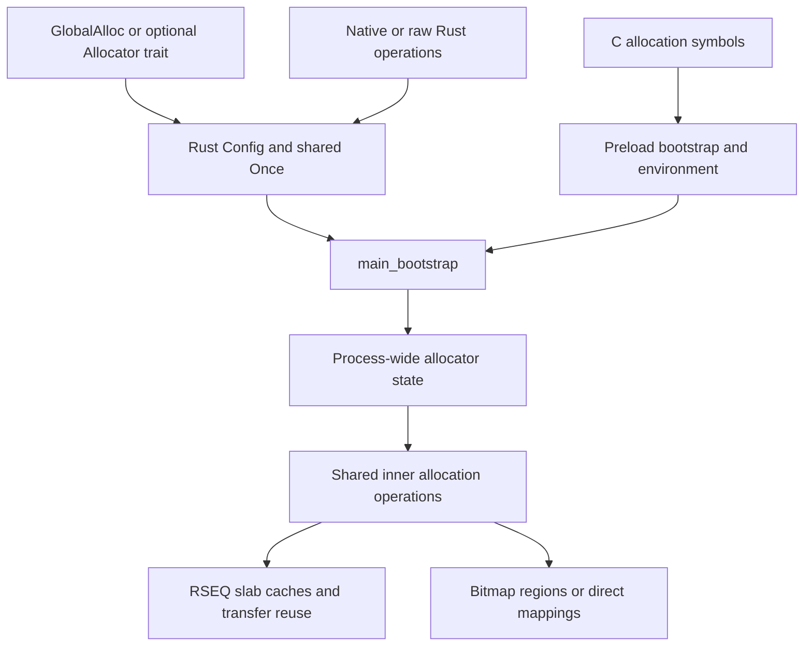

# Frontends, Bootstrap, and Process-wide State

RSMalloc exposes several interfaces, but they converge on shared allocation machinery. This chapter follows a request from its public boundary to initialized allocator state. The following chapters cover the [CPU-local path](architecture-rseq.md), [transfer reuse](architecture-transfer.md), and [backing memory](architecture-backing-memory.md).

Source anchors: `src/lib.rs`; `src/frontend/mod.rs`;
`src/frontend/global_alloc2/{alloc,config,raw,allocation_api,helpers}.rs`;
`src/frontend/abi/{malloc,calloc,free,realloc,align}.rs`;
`src/backend/bootstrap.rs`; `src/inner/preload/bootstrap.rs`.

## One implementation, several contracts

The diagram shows initialization and dispatch conceptually, not a claim that every free or every already-initialized allocation calls all these functions.

| Boundary | Internal dispatch | Contract remains the caller's responsibility |
| --- | --- | --- |
| `GlobalAlloc::alloc` | Initialize, then `rs_alloc` for alignment <=16 or `memalign_inner` otherwise | Valid Rust allocation layout; null failure handling. |
| `GlobalAlloc::dealloc` | `rs_free`; the implementation ignores the supplied layout | Rust still requires a matching allocation/layout and a live pointer. |
| Optional `Allocator` | Layout helpers returning `NonNull<[u8]>` or `AllocError` | Allocator-trait ownership, layout, and grow/shrink rules. |
| Native `AllocationAPI` | Byte-count methods translated to inner operations | Explicit buffer ownership, initialization, and alignment. |
| `RawInterface` | Thin unsafe wrapper borrowing an `RSMalloc` | Raw pointer contracts and explicit cleanup. |
| C ABI | Exported malloc-style symbols, with validation/error translation | C/POSIX API-specific contracts; interposition is not universal ownership. |

Frontend translation is meaningful. For example, the optional `Allocator` slice reports the requested layout size rather than all usable capacity. Its resize helper uses at least one physical byte for a zero-size new layout and still reports the requested logical slice length. Native resizing instead frees a live block on a zero-byte request. Do not transfer one frontend's zero-size semantics to another.

`helpers.rs` offers alignment constructors and constants; these describe address alignment, not SIMD instruction availability, page protection, or typed initialization. `AllocationSize` carries bytes, not a Rust `Layout`.

## Build-time frontend selection

`src/frontend/mod.rs` selects the C ABI with `preload`. Without it, the legacy and v2 Rust frontends are built. `src/lib.rs` re-exports v2 only in non-preload builds; therefore adding `preload` to a Rust dependency is not a way to enable both integration examples simultaneously.

The default build is stable Rust. `allocator-api` adds the optional unstable trait interface; `native-allocation-api` independently exposes the stable native interface. Feature resolution is additive across dependencies, so the final feature set matters more than one dependency declaration.

Legacy `RSMallocConfig` converts through `legacy_config_to_v2!` where applicable. The conversion preserves ordinary tuning but rejects fixed magic, ignored foreign pointers, and incompatible arena alignment. It uses the v2 big trim default because the legacy configuration has no separate big threshold. Compatibility conversion is not silent permission to weaken protection.

## First initialization wins

`RSMalloc` stores a `Config`, but its const constructor performs no allocation and creates no heap. Its `init` uses `GLOBAL_ALLOC_ONCE` and passes the winning instance's translated settings to `main_bootstrap`.

The allocator's internal `Once` has three states:

| State | Meaning | Transition |
| --- | --- | --- |
| 0 | Not started | Acquire CAS from 0 to 1 elects the initializer. |
| 1 | Initialization in progress | Other callers spin until state 2. |
| 2 | Completed | Release store publishes completion; callers observe it with Acquire. |

Source: `src/internals/once.rs` — `Once::call_once`, `start`.

This is a small spin-based once primitive, not `std::sync::Once` with a general panic/recovery contract. It has no poison/retry branch in `start`: completion is stored after the callback returns. Never infer that failed or recursive bootstrap is recoverable just because a public allocation method normally reports null on OOM.

Global Rust runtime activity can initialize the allocator before `main`. Native or maintenance calls can also win initialization. Distinct `RSMalloc` values must therefore use a consistent configuration; neither a late `manual_init` nor a later environment change can reconfigure already initialized state.

In preload builds, `src/inner/alloc.rs` has a separate frontend `ONCE`; `rs_alloc` calls preload bootstrap before dispatch. The underlying state is still process-wide. Pointer-based frees assume a valid allocation lifecycle, not a new initialization route for arbitrary foreign pointers.

## Bootstrap in actual dependency order

`main_bootstrap` currently performs these steps:

1. **Check libc RSEQ exports.** Zero `__rseq_size` or `__rseq_offset` logs `RseqUnavailable` and aborts. The allocator does not register RSEQ itself. This check is not a proof of every thread's later RSEQ state.
2. **Prepare checked sizes and policy.** Clamp arena size to `MIN_ARENA_SIZE` and checked-round it to 4 KiB; checked-round the initial bitmap region size to a power of two with a 64 MiB minimum. Cap relief percentages and combine bitmap huge-page policy with general THP support. Size overflow logs `RSMallocError::Bootstrap` and aborts.
3. **Initialize the time origin.** `get_clock` publishes an `Instant`; lifetime stamps use 100 ms units. Debug builds also record start time.
4. **Randomize magic and alignment tags**, when configured; a zero alignment tag is regenerated.
5. **Apply the prepared policy.** Install reservation/refill, region, trim-enable, relief, THP, and Rust foreign-pointer settings, but temporarily set **both trim thresholds to `usize::MAX`** to suppress worker startup during subsystem initialization.
6. **Create the ownership radix** with `RADIX.init()`. Later slab and region registration depends on it.
7. **Ensure the slab cache/topology table.** This maps CPU-indexed cache state and search bitmaps, parses NUMA information, and initializes the pending queue.
8. **Calculate the effective big trim threshold.** Use `max(requested, initial_cached_bytes + 1)`, with the footprint calculated from the normalized initial region, page-rounded region metadata, and page-rounded state/node/hint tables for the discovered topology. A lower requested threshold is raised to that minimum. Footprint or `+ 1` overflow logs `RSMallocError::Bootstrap` and aborts.
9. **Initialize page-arena node state.** Node count comes from the slab topology representation.
10. **Initialize the segmented-bitmap backend.** Huge-page attempts require both its setting and general THP support.
11. **Register preload fork handlers**, when that frontend is selected.
12. **Restore thresholds last.** Install the requested small threshold and effective big threshold. Worker startup remains lazy: a later refill/growth checks them after the caller's initialization gate.

Source: `src/backend/bootstrap.rs` — `BootstrapConfig::prepare`,
`PreparedBootstrapConfig::{apply,big_trim_threshold}`, `main_bootstrap`;
`src/big_allocations/segmented_bitmap.rs` — `initial_cached_bytes`,
`region_metadata_size`, `state_metadata_size`;
`src/global_vals.rs` — `get_clock`; `src/core_prim/random.rs`;
`src/rseq_core/slab_cache.rs` — `ensure_cache`.

Ordering matters: cache/topology initialization precedes node-specific backing state, and ownership state exists before ranges are registered. Runtime globals are not advertised as mutable tuning controls; frontend once-completion is part of their initialization discipline.

## Cache and topology bootstrap

`SlabCache::ensure_cache` maps `MainCache` storage for CPU indexing, with extra capacity for the indexing layout. Anonymous zeroed mappings establish empty lists and initial predictor state. It also maps the nonempty and being-stolen hint bitmaps.

NUMA parsing can fail. The fallback uses a non-NUMA topology rather than promising locality. With NUMA enabled, cache memory is bound by the represented CPU ranges; backend allocations prefer nodes separately. These are different placement operations, and errors/restrictions or irregular topology still affect physical locality.

Pending queue storage is initialized in this phase. Unlike mandatory cache mappings, queue mapping failure can leave null queue storage after its `Once` completes. Later failed publication can strand unfinished refill capacity; see [deferred initialization](architecture-refill.md#claiming-and-publishing-unfinished-extents). Do not generalize mandatory-bootstrap error behavior to every subsystem.

## Environment parsing is frontend policy

Preload bootstrap reads `RS_*` variables and constructs `BootstrapConfig`. It normalizes region size and relief percentages before common bootstrap. `Config::bootstrap` performs the corresponding translation for Rust, preserving private security state.

Current preload details include:

- decimal byte counts, with a parser that consumes leading digits rather than validating a human-readable size string;
- absence selects the default, while malformed leading text can produce zero;
- `RS_ENABLE_RELIEF=0` enables relief; nonzero disables it;
- exactly `RS_DISABLE_THP=1` disables general attempts;
- nonzero `RS_DISABLE_RANDOMIZING` retains fixed magic/tag values;
- initial bitmap region size is clamped to 64 MiB–128 TiB and rounded to a power of two; later growth is a separate policy;
- re-enable pressure is capped at the disable percentage.

Source: `src/inner/preload/bootstrap.rs`; `src/internals/env.rs`;
`src/frontend/global_alloc2/config.rs` — `Config::bootstrap`.

These are current implementation details, not a recommended configuration format to imitate. See the [preload reference](preload.md#runtime-configuration-set-it-before-bootstrap) for defaults and launch examples.

## C wrappers and error translation

C wrappers do not merely rename the Rust traits:

- `malloc`/`calloc` set `ENOMEM` when inner allocation returns null.
- `realloc` sets it for a null nonzero-size result, not deliberate zero-size release.
- `reallocarray` checks multiplication before calling resize.
- `recallocarray` has its own algorithm: nonzero shrink explicitly clears the discarded suffix in place; zero-size resize clears the entire old logical payload, frees the allocation, and returns null. Growth allocates zeroed replacement storage, copies the accurate old logical byte count, explicitly clears the old storage, then frees it. It does not rely on ordinary realloc releasing storage before erasure.
- Sized free shims ignore the supplied size/alignment and call ordinary free.
- `aligned_alloc` requires nonzero power-of-two alignment and size divisible by alignment. `posix_memalign` returns an error code rather than a pointer result.
- `pvalloc` checks page-rounding overflow; `valloc` requests 4 KiB alignment.
- `malloc_trim` uses an allocator byte target, not glibc's top-chunk padding contract. Its bitmap pass is age-based, unlike the forced bitmap pass used by the v2 core trim API.

Source: `src/frontend/abi/*.rs`. The pointer lifecycle and failure branches are covered in [ownership and resizing](architecture-ownership.md).

## Foreign fallback is conditional, not ownership transfer

Preload fallback resolves `free`, `realloc`, and `malloc_usable_size` through `dlsym(RTLD_NEXT, ...)`, cached in internal `OnceLock` values. Fork handling resets these symbol caches. Missing symbols produce return/no-result behavior specific to each wrapper, not a fully general allocator bridge.

Source: `src/inner/fallback.rs`; `src/inner/preload/libc_int.rs`;
`src/internals/oncelock.rs`; `src/core_prim/fork.rs`.

Default free classification reads presumed metadata before fallback is reached. `validate-foreign-first` changes that ordering, but radix ownership is coarse. Interposition and fallback never authorize passing interior, stale, or arbitrary pointers. Separate loader namespaces and other interposers also change what `RTLD_NEXT` resolves.

## Failure and observation boundaries

Public allocation failure can be recoverable null/`AllocationError`/`AllocError`, while internal mandatory metadata or bootstrap failure can abort. `RSMallocError::log_and_abort` logs then terminates; it does not return an error to every public frontend. Its `Bootstrap` branch writes the static reason directly to stderr with the write syscall, avoiding allocation and Rust stderr locking while initialization may be incomplete. Alpha allocation APIs are not a promise that all resource exhaustion is recoverable.

Diagnostics are another frontend on shared state. Structured reports initialize the allocator, allocate report storage, scan independently sampled state, and free their buffers on drop. Printer formatting and arena reporting can allocate or acquire locks too. `debug-exact` names additional instrumentation, not an atomic or observationally neutral snapshot.

Source: `src/result_handling.rs`; `src/frontend/global_alloc2/debug.rs`;
`src/frontend/global_alloc.rs`; `src/debug_exit_printer.rs`;
`src/debug_printer_thread.rs`. See [concurrency and observation](architecture-concurrency.md) before interpreting counters as exact ownership, syscall, or live-byte measurements.
