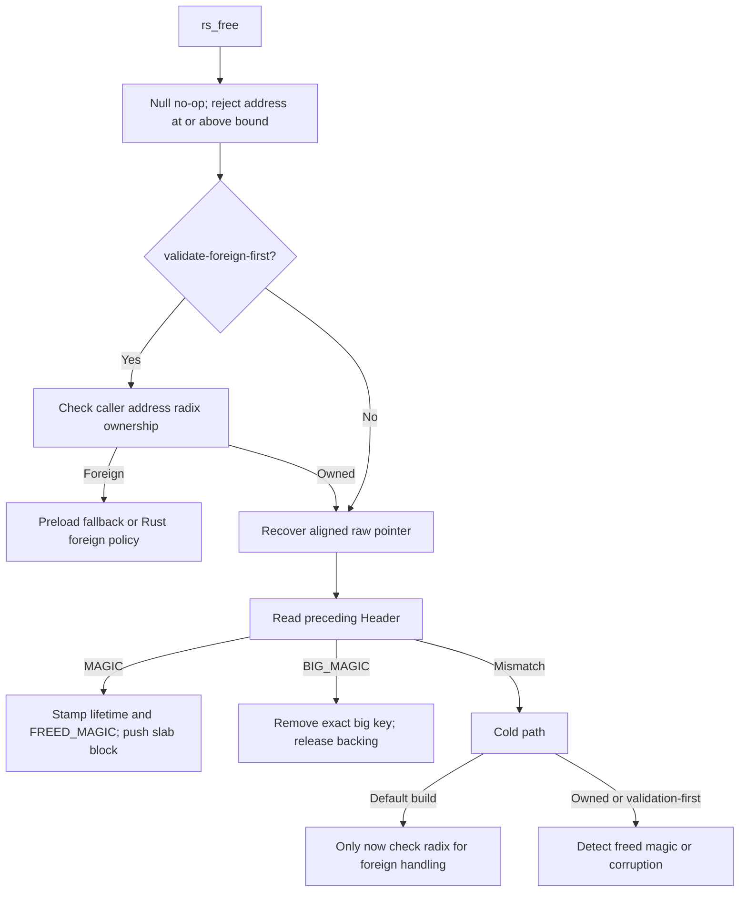

# Ownership, Allocation Metadata, and Process Lifecycle

RSMalloc does not keep a universal exact map of every live slab object. It combines coarse address
registration, per-object headers, aligned-pointer prefixes, and an exact metadata map for large allocations.
Each answers a different question. None makes arbitrary pointers valid allocator inputs.

Source: `src/lib.rs` — `Header`, `BigAllocMeta`, `MetaData`; `src/internals/radix_tree.rs` — `RadixTree`;
`src/internals/big_meta_map.rs` — `BigMetaMap`.

## Representation and authority

| Representation | Answers | Does not establish |
|---|---|---|
| Radix bit | Whether this 4 KiB address chunk was registered | Exact allocation start, liveness, or initialized contents |
| `Header.magic` | Lightweight live-small / freed-small / big classification | Unforgeable ownership or complete double-free detection |
| `Header.class` | Slab payload capacity and cache destination | Original requested byte count |
| `Header.flags` | Payload allocation/reclamation provenance | Whether the object is currently free; magic/list state is separate |
| Aligned prefix | Recover the original payload pointer | A remembered requested alignment or authenticated offset |
| `BIG_MAP` entry | Exact original big-payload key and allocation metadata | Safety of concurrent use/free of the same allocation |
| Free-list head / backend bitmap | Availability controlled by that structure | General pointer validation |

These are authoritative within their intended roles, not interchangeable proofs. Predictor values, search
hints, timestamps, and sampled inventory are policy. Ownership bits themselves are exact bit state but only a
**coarse classification**.

## Header and magic values

Default `Header` is `repr(C, align(16))`, size 16, with fields in this order: `next`, `flags`, `class`, 16-bit
`magic`, and 32-bit `life_time`. `extended-header` changes it to size 32 with `next`, 64-bit `magic`, `flags`,
`life_time`, and `class`. RSEQ assumes the link is first; changing layout is not merely a metadata
optimization. Ordinary payload starts one header later.

`Flags` is an 8-bit enum: `NotAllocated=1`, `Allocated=2`, `Reclaimed=3`, `BigAlloc=4`. Fresh small headers
start with `FREED_MAGIC` and `NotAllocated`. Allocation stamps `MAGIC`; ordinary allocation also sets
`Allocated`. Small free stamps `FREED_MAGIC` but normally leaves flags unchanged. Large headers use
`BIG_MAGIC` and class sentinel 100.

Bootstrap normally calls `init_magic` and `init_align`. `getrandom` supplies three distinct small/freed/big
magic values (16 or 64 bits depending on layout) and a word-sized alignment tag. Random-source failure aborts.
Bootstrap retries a zero alignment tag; it does not require magic values themselves to be nonzero. Fixed
initial values remain when randomization is disabled. Wider/randomized magic makes accidental or crafted
matches less likely, not impossible.

Source: `src/lib.rs` — `Flags`, both `Header` definitions; `src/global_vals.rs` — magic values, `ALIGN_TAG`;
`src/core_prim/random.rs` — `init_magic`, `init_align`; `src/backend/bootstrap.rs` — `main_bootstrap`.

## Aligned allocations have a recoverable prefix

`posix_align_inner` requires a non-null output pointer and a power-of-two alignment at least pointer size. It
checked-adds `size + alignment + TAG_SIZE`, allocates that raw payload with `aligned=true`, then finds the
aligned address at or after `raw + TAG_SIZE`. On x86-64, `OFFSET_SIZE=8` and `TAG_SIZE=16`:

```text
original header | raw payload ... | ALIGN_TAG | original raw payload pointer | aligned payload
                                  p - 16      p - 8                         p
```

Only successful allocation writes `*memptr`; invalid alignment returns EINVAL, and overflow/allocation failure
returns ENOMEM. `memalign_inner` raises small alignments to pointer size before validation; even `skip_checks`
still reaches `posix_align_inner`'s validation.

`find_original_ptr` unaligned-reads the tag at `p-TAG_SIZE`. A match causes an unaligned read of the raw
payload pointer at `p-OFFSET_SIZE`. With `validate-foreign-first`, that recovered address must also pass radix
ownership or the allocator aborts for possible prefix injection. There is no exact start/offset check or
stored requested alignment in this prefix. The `Owned` wrapper is not a checked-pointer abstraction: its
dereference implementation directly dereferences the raw pointer.

Source: `src/inner/align.rs` — `posix_align_inner`, `memalign_inner`; `src/inner/free.rs` —
`find_original_ptr`; `src/global_vals.rs` — `OFFSET_SIZE`, `TAG_SIZE`; `src/core_prim/wrappers.rs` —
`Owned`, `MaybeNull`.

## Radix: 4 KiB granularity over a bounded address space

`CHUNK_SIZE=4096`; addresses below `2^56` are represented as 44-bit chunk indices. `Radix::split` divides
those bits into `8 / 12 / 12 / 12` levels. L0 has 256 pointer entries; L1 and L2 each have 4096 pointer
entries per node. L3 is a bitmap of 4096 bits (64 `AtomicU64` words), not 4096 pointers. One leaf therefore
classifies 16 MiB of address space using 512 bitmap bytes.

Missing intermediate nodes are allocated lazily under one `alloc_lock`, with a second check after locking.
Zero-filled page/mmap memory supplies empty entries. Parent pointers are Release-stored and Acquire-loaded.
Bitmap registration uses Release `fetch_or`, clearing uses Release `fetch_and`, and lookup uses Acquire. An
update spanning multiple words is not an atomic range transaction. Lazy node allocation is not fallible at
this interface: if its page-backend attempt and mmap fallback fail, `Radix::map_memory` logs OOM and aborts.
Thus a successful slab page reservation can still encounter fatal metadata OOM during `RADIX.set`, rather
than returning a recoverable bulk-refill error.

`RadixTree::set` rejects zero sizes, overflow, and endpoints outside its bound; it marks every chunk
intersecting the inclusive byte range. `set_single_big` only changes the chunk containing one address.
`is_owned_inner` returns false before initialization. Its validating variant aborts on out-of-range addresses
after initialization; the nonvalidating variant returns false through the bounded `get` path.

Registration deliberately varies by backing type:

| Allocation backing | Registration | Removal on object free |
|---|---|---|
| Slab page extent | Logical extent range | None; small blocks return to caches |
| Segmented-bitmap region | Entire region at creation | None; backend marks its block free |
| Unaligned direct big mapping | Mapping base's single 4 KiB chunk | Clear that single chunk |
| Aligned direct big mapping | Entire mapped range | Clear recomputed mapping range |

Thus `is_owned` is not a general containment query for all bytes of every big allocation: an ordinary direct
big mapping intentionally registers only its header/payload-start chunk. Region membership can survive an
object's free. Metadata pages are not automatically registered just because they back radix nodes or map
entries.

Source: `src/internals/radix_tree.rs` — constants, `map_memory`, `get_or_alloc`, `set_range`,
`RadixTree::{set,set_single_big,is_owned_inner}`; `src/rseq_core/bulk_fill.rs` — `alloc_metadata`;
`src/big_allocations/big_allocation.rs` — `big_malloc`, `big_free`; `src/big_allocations/segmented_bitmap.rs`
— `create_region`.

## Exact big metadata, sharded rather than globally locked

`BIG_MAP` aliases `BIG_META_MAP`, a `BigMetaMap` with 64 cache-line-aligned shards and 64 buckets per shard.
It hashes the exact original payload address (starting with `key >> 4` and mixing it), selects low six hash
bits for the shard and the next six for the bucket, then compares full keys in chained nodes. Each operation
holds that shard's `internals::fork_lock::SpinLock`. There is no single map-wide lock in ordinary operation.

`get` copies `BigAllocMeta`; `replace` returns the old value while retaining the key; `remove` unlinks and
recycles the node on the shard free list. Chunks contain 64 nodes and come from the page backend or mmap
fallback. Metadata allocation failure aborts rather than returning a failed map insertion. `BigAllocMeta`
contains requested payload `size`, backing `order`, segmented backend handle `segmented_bitmap_region`, and
whether aligned allocation was used. The region handle here identifies a segment for backend free/grow.

`big_malloc` initializes the header and registers ownership before inserting the exact payload key and
returning it. `big_free` removes that key first; a missing key is corruption/possible double free. Segmented
allocations go back to their backend. Direct allocations clear radix registration, then `munmap`. No
transaction spans header, radix, map, and backend, and these locks do not permit concurrent realloc/free of
one live allocation by the application.

Source: `src/internals/big_meta_map.rs` — `location`, `insert`, `get`, `replace`, `remove`, `alloc_chunk`;
`src/big_allocations/big_allocation.rs` — `big_malloc`, `big_free`.

## Free ordering: default versus validation-first



Default free reads prefix/header metadata **before** ownership classification. A foreign pointer can fault,
collide with a magic value, or be misclassified before fallback/ignore/abort policy is reached.
`validate-foreign-first` moves the caller-address check ahead of those reads and validates a recovered aligned
raw pointer, but cannot reject interior pointers within an owned chunk reliably. `check-owned-on-alloc` is a
separate optional check before stamping a popped allocation; it is not a full freelist-integrity proof.

For owned small blocks, free stamps `CURRENT_STAMP` and `FREED_MAGIC`, optionally zeros classes 0 through 3
(`zero-small-on-free`), and pushes the header. On mismatch, `FREED_MAGIC` aborts as double free and other
values abort as corruption unless `disable-magic-security-checks` is enabled. That feature suppresses these
mismatch aborts; it does not remove all metadata reads or big-map checks. Direct big double-free can encounter
unmapped memory before any diagnostic. Valid callers must still avoid all double frees.

Preload foreign handling invokes `RTLD_NEXT` functions resolved by `dlsym` and cached in three `OnceLock`s.
Missing fallback `free` silently returns; missing `realloc` returns null; missing `malloc_usable_size` returns
zero. Rust mode follows the process-wide `FOREIGN_POINTER_ABORT` setting (configured by frontend/bootstrap),
otherwise ignoring detected foreign frees. Source: `src/inner/free.rs` — `rs_free`, `cold_path`;
`src/inner/alloc.rs` — `is_owned!`, `usable_size`; `src/inner/fallback.rs` — fallback functions.

## Calloc depends on payload provenance, not free magic

`rs_calloc` validates a byte layout, checks multiplication, and allocates `max(product,1)` using
`rs_alloc_no_flag`. This stamps live magic but preserves small-block flags for the zeroing decision.
`NotAllocated` can skip explicit zeroing because the payload was never exposed and comes from fresh
reservations. `Allocated`, `Reclaimed`, and `BigAlloc` require zeroing, bounded by the smaller of effective
requested size and class/big metadata capacity. Small calloc then sets `Allocated`; big calloc retains its
backing flag.

Fresh direct mmap big allocations use `NotAllocated`. Segmented big allocations are conservatively marked
`BigAlloc` by `big_malloc`, even though the backend returns more detailed provenance: calloc explicitly zeroes
them. Reclaimed small blocks are also explicitly zeroed: trim leaves header/boundary pages intact, and
`lazy-page-trim` uses MADV_FREE, which does not promise immediate zeroing. Default trim uses MADV_DONTNEED,
but the calloc branch still zeros. `explicit-zero` selects libc `explicit_bzero` instead of `write_bytes`.

Source: `src/inner/calloc.rs` — `calc_and_get`, `calloc_zero!`, `rs_calloc`, `zero`;
`src/rseq_core/bulk_fill.rs` — `init_blocks`; `src/big_allocations/big_allocation.rs` — `big_malloc`;
`src/rseq_core/slab_cache/reclaim.rs` — `release_memory`, `trim_small`.

## Realloc: retention, growth, replacement, and failure

`rs_realloc` validates an explicit Rust alignment first; invalid alignment returns null without freeing even
on a zero-size request. A null pointer allocates at least one byte. A non-null pointer resized to zero is
freed and returns null. Otherwise ownership is checked before aligned recovery/header classification; foreign
pointers use preload fallback or Rust foreign policy.

| Existing allocation | In-place route | Otherwise |
|---|---|---|
| Small ordinary | Fits old class capacity; selected one-block slab can grow at page-arena bump tail | Allocate replacement and copy |
| Big segmented | Fits recorded size or backing order; reserve adjacent space incrementally | Allocate replacement and copy |
| Big direct | Fits recorded size; grow with `mremap` and empty flags (no MAYMOVE) | Allocate replacement and copy |
| Offset/alignment upgrade | Fits usable capacity and observed pointer alignment | Aligned replacement and copy |

One-block slab growth requires both classes' `ITERATIONS` to equal one, recognized metadata immediately before
the header, a page-aligned base, and valid node ID. Page growth succeeds only if the arena cursor equals the
old reservation end; success updates metadata, class, radix range, and cached bytes. Segmented growth updates
map order after each successful expansion, even if a later step fails. Failure preserves the original data and
valid allocation, but can retain partially expanded backing. Direct growth retains the address; the
implementation replaces big metadata but does not add radix range bits in that branch. Shrinking generally
retains capacity and does not physically trim.

Replacement allocates first, returns null on failure, then copies `min(old class/metadata/offset-adjusted
usable size, new_size)` and frees the old allocation. New extension bytes are not initialized by ordinary
realloc. Alignment is inferred as `1 << trailing_zeros(address)`, not recovered from a stored request. Rust
`None` preserves observed alignment; preload preserves it for offset allocations but uses 16 for ordinary
ones. Alignment above 16 takes `memalign_inner`; a stronger alignment alone can force a move. Source:
`src/inner/realloc.rs` — `rs_realloc`, `small_realloc`, `big_realloc`, `aligned_realloc`,
`replace_allocation`, `observed_alignment`; `src/backend/page_allocator.rs` — `try_grow_inplace`;
`src/big_allocations/segmented_bitmap.rs` — `try_grow_inplace`.

## Frontend contracts and POSIX boundaries

| Frontend | Source-backed behavior |
|---|---|
| C preload | `malloc`/`calloc` failures set ENOMEM; `realloc(p,0)` frees without setting ENOMEM |
| C aligned APIs | `posix_memalign` returns error codes; `aligned_alloc` also enforces size multiple; `pvalloc` checks rounding overflow |
| C sized frees | Ignore supplied size/alignment and delegate to `free` |
| Rust `GlobalAlloc` | Layout selects alignment; deallocation uses metadata, not supplied layout; aligned zeroed allocation explicitly zeros |
| Native `AllocationAPI` | Fallible allocation; null-plus-zero realloc is `NotSupported`; non-null-to-zero is `Ok(null)` |
| Nightly `Allocator` | Reports requested slice length; zero-size resize uses real backing via `max(1)`; `grow_zeroed` zeros extension |

C `reallocarray` checks product overflow without releasing the old allocation. `recallocarray` explicitly
clears discarded bytes; growth allocates zeroed replacement, copies, clears old storage, then frees. It
requires accurate old size and does not provide the ordinary aligned-realloc preservation route. These
implemented APIs are not a blanket POSIX/libc compatibility certification. Foreign fallback remains
best-effort; neither allocation nor free is made async-signal-safe by metadata checks. Rust unsafe
pointer/layout contracts apply regardless of forgiving runtime policy. Source:
`src/frontend/abi/{align,calloc,free,malloc,realloc}.rs`; `src/frontend/global_alloc2/alloc.rs` — frontend
trait implementations; `src/frontend/global_alloc2/raw.rs` — `RawInterface`;
`src/frontend/global_alloc2/allocation_api.rs` — safety contracts; `src/frontend/global_alloc.rs` — legacy
`GlobalAlloc` and raw methods.

## Initialization and fork-aware lock lifecycle

Rust frontends share `GLOBAL_ALLOC_ONCE`; first initialization applies global configuration. Preload
allocation has its own bootstrap `Once`. `Once` uses states 0/unstarted, 1/running, 2/complete with
Acquire/Release publication. It spins while incomplete; it has no general panic recovery or automatic child
reset. `OnceLock` writes its value before completion publication. Only fallback symbol cells are explicitly
reset in the child handler.

Without preload, `fork_lock::SpinLock` aliases the ordinary boolean spinlock. With preload it is `ForkLock`:
zero is free, bit 0 is HELD, bit 1 is FROZEN, and higher bits encode the preparing thread's TID. A freeze
waits for zero and Acquire-CASes a reservation without creating a mutable data guard. The owner can
temporarily borrow by setting HELD; guard drop Release-restores the frozen state. A second blocking borrow
aborts; `try_lock` fails instead. It is deliberately not a recursive mutex.

`can_borrow_frozen_lock` allows the original TID or, while a prepared PID is recorded, the surviving Linux
child leader (`pid != prepared_pid && tid == pid`). That second rule lets older child callbacks borrow before
RSMalloc's callback. Thaw requires a frozen, unheld state and authorized caller, otherwise aborting.

The registered `pthread_atfork` lifecycle is:

1. **Prepare:** hold `BOOTSTRAP_LOCK`, record PID, hold `GLOBAL_TRIM_LOCK`,
   then freeze segmented growth locks, all big-map shards, radix allocation
   lock, and page-arena locks, in that order.
2. **Parent:** thaw page, radix, map, segmented locks in reverse subsystem order;
   drop trim guard, clear prepared PID, drop bootstrap guard.
3. **Child:** same thaw; reset fallback symbol cells; drop trim guard;
   reset `RECLAIM_GUARD`; require nonzero RSEQ size/offset; clear PID and
   drop bootstrap guard. Future qualifying allocation can restart reclamation.

Source: `src/core_prim/fork.rs` — handlers, `can_borrow_frozen_lock`, `register_fork_handlers`;
`src/internals/fork_lock.rs` — `ForkLock`; `src/internals/{lock,once,oncelock}.rs`;
`src/backend/background_thread.rs` — `maybe_start_background_reclaimer`.

This supports allocator-specific coordination for registered preload `fork` handlers, including selected
callback allocation paths. It does not freeze all lock-free RSEQ/transfer/pending operations, reset every once
cell, or establish a global heap snapshot. Registration ignores `pthread_atfork`'s return code. Raw fork
syscalls, `_Fork`, and `vfork` do not gain these handlers; Rust-only mode has no corresponding registration.
Arbitrary callback recursion, signal-handler allocation, loader-lock interactions, and allocation after a
multithreaded fork before exec are not certified safe. POSIX permits only async-signal-safe operations in that
child interval; allocator lock engineering does not relax that application constraint. The implementation
currently supports Linux x86-64 with usable RSEQ, not portable POSIX platforms. Source:
`src/core_prim/fork.rs`; `src/backend/bootstrap.rs` — `main_bootstrap`; `src/lib.rs` — target compile errors.
