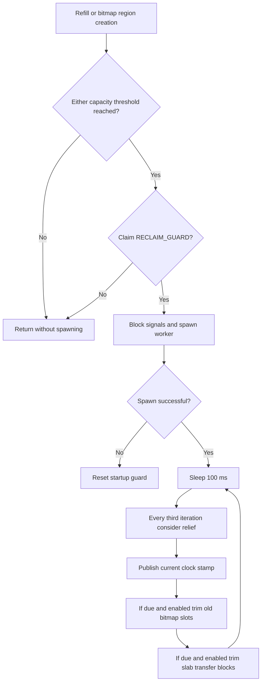
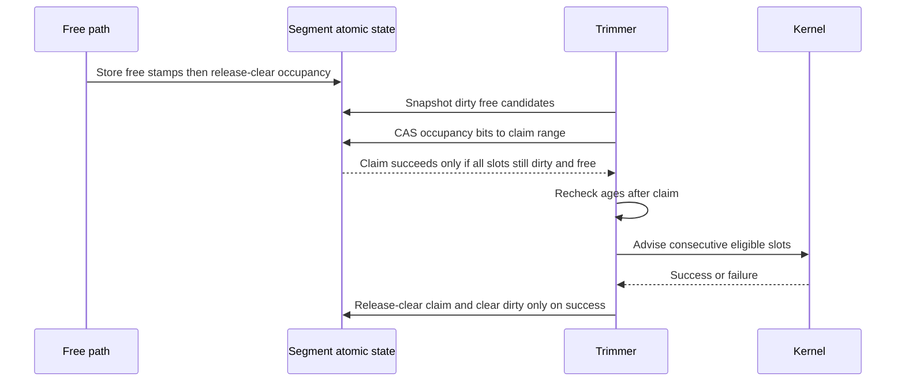

# Reclamation and Pressure Relief

Reclamation targets **free allocator-owned storage**. Bitmap trimming claims
free slots before advice; slab trimming detaches and partitions transfer lists.
Ordinary free makes memory reusable; advice makes eligible pages reclaimable by
the kernel; unmapping removes a mapping. These are separate events.
The [backing-memory chapter](architecture-backing-memory.md) describes the
persistent arena and region ownership behind those distinctions.

Source citations use repository-relative paths and symbols, not URLs into the
repository's `src/` tree that would break in the rendered book.

## What the reclaimer can reach

There are two trimming subsystems:

- Slab trimming visits normal transfer lists for payload classes starting at
  4096 bytes. It does not drain every CPU-local cache or pending refill span.
- Bitmap trimming visits published regions and dirty free slots. Each slot
  covers 4 MiB; live slots and temporary trim claims are unavailable.

Direct large mappings do not enter either scan: `big_free` unmaps them directly.
Page arenas and bitmap regions normally remain virtually reserved after trim.
Their metadata remains available for subsequent allocation and free operations.

Source: `src/rseq_core/slab_cache/reclaim.rs` — `SlabCache::trim_small`;
`src/big_allocations/segmented_bitmap.rs` — `trim_inner`;
`src/big_allocations/big_allocation.rs` — `big_free`.

## Capacity thresholds are not RSS thresholds

The common gate permits age-based trimming if **either** capacity counter is at
or above its threshold:

```text
TOTAL_CACHED_VA >= SMALL_TRIM_THRESHOLD
    OR
SEGMENTED_BITMAP_TOTAL_CACHED_VA >= BIG_TRIM_THRESHOLD
```

Defaults in `global_vals` are 10 MiB for slab capacity and 512 MiB for bitmap
capacity. Bootstrap rejects a configured bitmap threshold below 128 MiB.
Both counters track supplied backing capacity, including storage not currently
free. They are not measurements of resident RAM or the number of eligible pages.
Slab bulk-fill accounting adds its logical span total; page reservation can be
larger because the page allocator rounds it. Bitmap accounting includes region
data, region metadata, and the state allocation.

Successful trim does not subtract from these capacity counters. A threshold
crossing is therefore not undone merely by advising pages away. Reclamation can
keep scanning retained virtual capacity after physical pages have been released.

Source: `src/global_vals.rs` — thresholds, `add_slab_cached_va`,
`add_segmented_bitmap_cached_va`;
`src/rseq_core/bulk_fill.rs` — `alloc_metadata`;
`src/backend/bootstrap.rs` — `main_bootstrap`;
`src/big_allocations/segmented_bitmap.rs` — `init`, `create_region`.

## Lazy worker startup

`maybe_start_background_reclaimer` runs after successful slab refill and during
bitmap region creation. It returns when both counters are below their thresholds
or `RECLAIM_GUARD` already indicates a worker. A compare-exchange claims startup;
spawn failure resets the guard so a later opportunity can retry.

The worker is named `rsmalloc-trimmer` and requests a 64 KiB stack. Startup blocks
signals in the creating thread, except glibc internal signals 32 and 33, so the
new thread inherits that mask; an RAII guard restores the creator's prior mask.
Failure to obtain the mask prevents spawning. A successful worker runs forever;
there is no normal idle-stop or join path in this implementation.

`DISABLE_TRIM_THREAD` is checked by the loop, **not by the startup gate**. Disabling
periodic trimming does not by itself prevent worker creation, timestamp updates,
or opt-in pressure relief.

Source: `src/backend/background_thread.rs` — `SignalMaskGuard`, `spawn`,
`maybe_start_background_reclaimer`, `RECLAIM_GUARD`;
`src/inner/alloc.rs` — `refill`;
`src/big_allocations/segmented_bitmap.rs` — `create_region`.



## Clock and scheduling

`get_clock` initializes a shared `Instant`. The worker publishes
`CURRENT_STAMP = elapsed_milliseconds / 100` as a `u32` every iteration, after
its relief check. Slot and header ages use saturating subtraction, avoiding
negative ages but not providing special handling for eventual stamp wraparound.
This is a sampled 100 ms age clock, not a per-free call to `Instant::now`.

Before worker startup the stamp can remain zero. Explicit trim does not refresh
it. Even after startup, slow scans or scheduler delays can make it stale; the
sleep interval is not a guaranteed reclamation deadline.

The loop has independent latest-run stamps:

| Subsystem | Scheduling condition | Initial average |
| --- | --- | --- |
| Bitmap | Elapsed stamps strictly greater than bitmap average | 55 ticks |
| Slab | Elapsed stamps strictly greater than `max(slab average, 30)` | 10 ticks |

A due run updates its latest-run stamp **before** calling the backend. A gate or
try-lock miss can therefore postpone another attempt until the next scheduling
interval. Due order is bitmap first, then slab. Both periodic calls use zero as
an unbounded target; backend eligibility still limits the work.

Source: `src/global_vals.rs` — `get_clock`, `CURRENT_STAMP`, average atomics;
`src/backend/background_thread.rs` — `background_reclaimer_main`.

## Bitmap eligibility and synchronization

`trim_old` calls `trim_inner` with `force = false`: it applies the common
capacity gate and requires slot age strictly greater than the sampled bitmap
average. `trim` sets `force = true`, bypassing **both** that gate and age checks.
Neither mode can reclaim occupied slots or clean, never-used slots.

Both modes load the published state and try `GLOBAL_TRIM_LOCK`. A busy lock or
uninitialized backend returns zero immediately. Region traversal uses stable
published lists; it need not hold each node's growth lock. Concurrently published
regions may or may not enter a particular scan.

A segment's atomic word has occupancy, dirty, and history planes. The initial
candidate mask is `!occupancy & dirty`. Free stamps every slot before
release-clearing occupancy; trim sees state through acquire operations.
A candidate snapshot alone is insufficient permission to advise pages.



`trim_segment` initially groups consecutive candidates, then rechecks each slot's
age after claiming. Too-young slots are released without advice. Eligible runs
become contiguous `madvise` calls. Allocation and growth cannot acquire claimed
slots; if an allocator wins first, the trim claim fails instead.

Advice success clears dirty and occupancy while preserving history. Failure
preserves dirty; the advised range receives the current free timestamp in either
case. Failed advice can thus delay an age-based retry. Requested limits round
work to whole 4 MiB slots and can overshoot. Unprocessed claims are released.
Only successful advice contributes bytes to the bitmap report.

Source: `src/big_allocations/segmented_bitmap.rs` — `trim`, `trim_old`,
`trim_inner`, `trim_segment`;
`src/big_allocations/segmented_bitmap/segment.rs` — `dirty_free`, `age`,
`claim_trim`, `finish_trim`, `free`, `alloc`, `grow`.

### Adaptive bitmap ages

`TrimStats` samples free-slot ages, including too-young candidates, and gives
never-allocated free slots a synthetic age of 85 ticks. A sampled mean is clamped
to 10–85, blended with the prior average using `EMA_ALPHA = 0.25`, rounded, and
clamped again. That average affects both slot eligibility and worker scheduling.
A forced scan also feeds this estimator; it is not a policy-neutral operation.

Source: `src/big_allocations/segmented_bitmap.rs` — `TrimStats::finish`,
`trim_segment`; `src/core_prim/predictor.rs` — `EMA_ALPHA`.

## Slab eligibility and synchronization

`trim_small` always applies the common capacity gate and always tries the global
trim lock. There is no slab equivalent of bitmap `force`. It scans CPUs and
classes starting at `get_size_4096_class`, acquiring each transfer list's
`trim_lock` and atomically detaching the tagged **normal** list head.
It adjusts normal-block accounting as part of the detach.

Transfer pop consults that trim lock; the trimmer partitions the detached
chain. A block is eligible only when its age strictly exceeds the
class's `TRIM_SMOOTHING` time and its flag is `Allocated`. Never-used and already
`Reclaimed` blocks are retained rather than repeatedly advised.
Blocks still in CPU-local caches, the separate trimmed list, or pending spans
are not made eligible just because an explicit call says “all.”

Retained blocks return in batches to transfer storage. The per-list lock is
released before advice on the detached trim list. Candidates are republished
after their advice attempt. See [transfer trim coordination](architecture-transfer.md#trim-lock-coordination)
for the pop-side lock checks and forced-wait behavior.

Success changes the flag to `Reclaimed` and pushes to the trimmed transfer list.
Failure or reaching the requested target pushes the block normally. Candidate
lifetimes are reset to the scan stamp even when advice is skipped or fails.

Source: `src/rseq_core/slab_cache/reclaim.rs` — `trim_small`;
`src/rseq_core/slab_cache/transfer.rs` — `transfer_pop_batch`,
`transfer_push_single_trimmed`; `src/inner/free.rs` — `rs_free`.

`release_memory` advises only whole pages strictly inside the payload:

```text
page_start = round_up(header_address + Header::SIZE, 4096)
page_end   = round_down(header_address + Header::SIZE + class_payload_size, 4096)
```

Empty interiors return false. This preserves headers and payload boundary pages
that can share allocator metadata or neighboring storage. A 4096-byte class
usually has no full interior page, although it is in the scan range.

On success, slab return accounting adds the **class payload size**, not the
actual interior advice length. `TrimReport.slab_bytes` therefore is not an exact
count of pages advised or RSS bytes released. A bounded trim can overshoot by a
class-sized block; scanning and repartitioning continue beyond the byte target,
although further candidate advice stops.

Per-class age means exclude zero lifetime stamps and clamp observations to
1–100 ticks. `EmaSmoothing` weights a new observation by 0.25 and uses a ceiling.
Empty normal lists feed an observation of 100 unless `trim-aggressively` is
set. That feature suppresses this empty-list feedback; it does not remove age,
capacity, or full-page eligibility checks. The mean of class smoothing times
updates `AVERAGE_BLOCK_TIMES` for worker scheduling.

Source: `src/rseq_core/slab_cache/reclaim.rs` — `trim_small`, `release_memory`;
`src/core_prim/predictor.rs` — `EmaSmoothing`, `TRIM_SMOOTHING`.

### Trim telemetry is not a syscall-success ledger

With `debug`, `TOTAL_TRIM_CALLS` (exposed as `trim_calls`) increments only after
a subsystem passes its gates and acquires `GLOBAL_TRIM_LOCK`. It counts admitted
backend scans, including scans finding no reclaimable pages, not public API
calls. One combined request can admit two scans; rejected scans count neither.

With `debug-exact`, `TOTAL_TRIMMED_BLOCKS` (exposed as `trimmed_blocks_small`)
counts every slab candidate visited on `trim_list`, **before** the budget check.
It includes budget-skipped candidates, failed advice, and candidates for which
`release_memory` finds no complete interior page and makes no syscall.
`TOTAL_TRIMMED_TIME` accumulates cycle timing only inside the budget-allowed
release-attempt branch. That timing includes the `release_memory` check and
surrounding work, even when there is no advice syscall or it fails.

`avg_madvise_cycles_small` divides that timing by
`max(TOTAL_TRIMMED_BLOCKS, 1)`, not by actual syscall attempts or successes.
Budget-skipped candidates can lower the reported average without adding timed
work. Bitmap advice does not feed these slab candidate/time counters.
`TOTAL_TRIMMED_VA` combines successful bitmap advice lengths with successful
slab class-payload accounting; it is not an exact physical-release total.

Source: `src/rseq_core/slab_cache/reclaim.rs` — `trim_small` candidate and timing
loop, `release_memory`;
`src/big_allocations/segmented_bitmap.rs` — `trim_inner`, `TrimStats::finish`;
`src/frontend/global_alloc2/debug.rs` — `get_stats`, `get_exact_stats`.

## Explicit trim ordering and best-effort results

The v2 raw API initializes the allocator, then maps `AdvancedTrimSize` as follows:

| Request | Order and target |
| --- | --- |
| `All` | Forced bitmap `trim(0)`, then slab `trim_small(0)` |
| `AllSegmentedBitmap` | Forced bitmap only |
| `AllSlab` | Slab only, still capacity- and age-gated |
| `Bytes(n)` | Forced bitmap first; slab gets the positive remaining target |
| `SegmentedBitmapBytes(n)` | Forced bitmap only, bounded |
| `SlabBytes(n)` | Slab only, bounded |

Bounded variants contain `NonZero<usize>`. Zero passed internally means scan
without a byte limit, not disable trimming. `TrimReport` separates the two
subsystem counts; their accounting units differ as described above.
The raw calls release the global lock between subsystems, so a combined request
is not one atomic snapshot or transaction.

Source: `src/frontend/global_alloc2/raw.rs` — `AdvancedTrimSize`, `TrimReport`,
`RawInterface for RSMallocRaw::rs_trim`.

Do not generalize this ordering to every API. The v2 `RSMallocCoreAPI::trim`
tries slab **first**, then forced bitmap for the remainder. The preload
`malloc_trim` tries age-gated bitmap `trim_old` first, then slab, and returns
only a boolean-like success indicator. The caller's target is not a promise
that the kernel will free that many physical bytes.

Source: `src/frontend/global_alloc2/alloc.rs` — `RSMallocCoreAPI::trim`;
`src/frontend/abi/malloc.rs` — `malloc_trim`.

A zero result can mean no eligible pages, low capacity, a busy trim lock,
uninitialized bitmap state, or failed advice. A positive result means accepted
advice under the subsystem's accounting convention, not an RSS deadline.
Trim does not rewind arenas, unmap bitmap regions, or guarantee that all free
blocks are visited.

## Lazy page trim applies to both subsystems

Without `lazy-page-trim`, both backends use `Advice::LinuxDontNeed`.
With it, **both** bitmap `trim_inner` and slab `release_memory` use
`Advice::LinuxFree`. Lazy advice can leave old contents resident until the
kernel needs the pages; accepted advice is not immediate physical release.

Reused reclaimed slab storage is explicitly zeroed by calloc, and bitmap headers
always carry `BigAlloc`, which also triggers explicit calloc zeroing. Thus
reclamation flags do not license treating lazily advised payloads as already
zero. Ordinary allocation and realloc growth make no zero-content guarantee.

Source: `src/big_allocations/segmented_bitmap.rs` — `trim_inner`;
`src/rseq_core/slab_cache/reclaim.rs` — `release_memory`;
`src/inner/calloc.rs` — `calloc_zero`, `rs_calloc`.

Huge-page advice is independent of lazy trim. Page arena feature guards require
one THP feature and the absence of the other: enabling both
`page-backend-huge-page` and `page-backend-no-huge-page` suppresses **both arena
advice calls**, rather than giving either precedence. Region and direct-large
THP requests have separate runtime controls. Trimming page interiors or slot
runs can change the kernel's huge-page backing; no advice guarantees promotion,
demotion, or a particular fault cost.

Source: `src/backend/page_allocator.rs` — `new_arena_locked`;
`src/big_allocations/segmented_bitmap.rs` — `create_region`;
`src/big_allocations/big_allocation.rs` — `big_malloc`.

## Host pressure relief and hysteresis

Relief is opt-in: `DISABLE_RELIEF` defaults to true. The worker checks it every
third loop iteration using a nominal elapsed counter, approximately 300 ms plus
work and scheduling delays. Relief runs before that iteration's stamp update.
It is independent of the periodic trimming-disable flag.

`check_memory_pressure` uses host `sysinfo` RAM **and swap**, scaling fields by
`mem_unit`, then computes:

```text
used_percent = 100 * ((total_ram + total_swap) - (free_ram + free_swap))
                   / (total_ram + total_swap)
```

The subtraction saturates; zero total memory returns 50. This is not process
RSS, cgroup usage, or Linux `MemAvailable`: cached host pages can count as used,
and adding swap changes the denominator. It is a coarse policy signal.

At or above the default 85% disable threshold, relief sets
`DISABLE_SEGMENTED_BITMAP`, resets `UNDER_AFTER`, and calls forced bitmap
`trim(0)` once on that transition. New large requests then bypass bitmap reuse
and use direct mappings. Existing bitmap allocations remain valid and free back
to their original segments. Slab routing is not disabled.

While disabled, two consecutive checks at or below the default 80% enable
threshold re-enable bitmap routing. A check above that lower threshold resets
the count. This gap and two-sample requirement provide hysteresis; checks in the
intermediate band do not prematurely re-enable reuse.

The transition's forced trim is still try-lock best-effort. If it misses the
lock, disabling remains in effect; relief does not retry the forced call on
every disabled-state sample. Normal periodic age-based trimming can still run
unless explicitly disabled. Relief needs a started worker and therefore is
not an always-on monitor before allocator capacity crosses a startup threshold.

Source: `src/backend/background_thread.rs` — `check_memory_pressure`,
`relief_paths`, `ENABLE_AFTER`, `UNDER_AFTER`, `background_reclaimer_main`.

## Reclamation mechanisms and costs

- Bitmap atomic claims exclude allocation and growth from slots during advice.
- Slab trimming detaches normal transfer chains, partitions candidates, and
  republishes blocks after processing.
- Advice ranges preserve header pages and persistent arena/region reservations.
- Dirty/history flags distinguish reuse states but are not zeroing guarantees.
- Global try-lock serialization trades completeness for avoiding concurrent
  scans; per-list locks, CAS retries, list traversal, and syscalls still cost.
- Capacity, reported trimmed bytes, advised page bytes, RSS, and swap usage are
  different quantities. Measure them separately when evaluating reclamation.

The practical tradeoff is fewer retained physical pages versus scan overhead,
future page faults, zeroing work, and possible THP disruption. Neither automatic
nor explicit reclamation is a real-time memory-limit enforcement mechanism.
