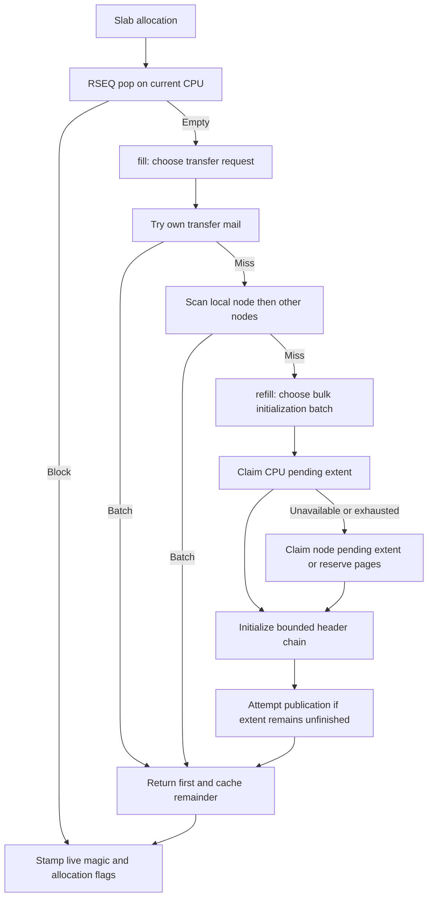

# Refill, Transfer Inventory, and Deferred Initialization

A slab allocation first tries a CPU-local RSEQ list. A miss invokes `fill`,
which tries existing transfer inventory before initializing more slab blocks.
These are different operations with separate predictors: transfer batching
moves already-initialized free objects; bulk batching decides how many new
headers to construct from a reserved page extent.

Source: `src/inner/alloc.rs` — `rs_alloc_inner`, `fill`, `refill`;
`src/rseq_core/slab_cache.rs` — `MainCache`, `GenericCache` implementation.

## State and policy are not interchangeable

| State | Scope | Meaning and authority |
|---|---|---|
| `RseqCache.list` | CPU/class | CPU-local linked-list head; RSEQ commits actual list changes |
| `RseqCache.usage` | CPU/class | Atomic accounting updated after the RSEQ head commit; sampled for policy |
| `TransferCache.list`, `trimmed` | CPU/class | Tagged heads of initialized free-block lists |
| `normal_blocks`, `trimmed_blocks` | CPU/class/list | Inventory counters, updated separately from head publication |
| `bitmap.nonempty` | Class/CPU | Relaxed search hint, not proof that a pop will succeed |
| `bitmap.being_stolen` | Class/CPU | Coordination hint, not an exclusive ownership lock |
| `transfer_batching` | CPU/class | Approximate request policy; does not establish block ownership |
| `bulk_fill_batching` | CPU/class | Approximate initialization policy, separate from transfer policy |
| `pending_refill` | CPU/class | Atomic pointer handoff for one partially initialized extent |
| `MetaData.next`, `end` | Reserved extent | Cursor and logical end, used exclusively by the claiming refill |

Source: `src/rseq_core/slab_cache.rs` — `SizeList`, `RseqCache`,
`TransferCache`, `MainCache`, `TransferReturn`; `src/lib.rs` — `MetaData`.



## Class limits and initial values

Write `S = SIZE_CLASSES[class]`, `H = Header::SIZE`, and
`B = align_up(S + H, 16)`. The nominal fresh-refill limit is:

```text
T = 32768 bytes if S <= 128, otherwise 16384 bytes
I = ITERATIONS[class] = max(1, floor(T / B))
```

`CACHE_HIGH_BLOCKS` uses 128 KiB for payloads below 256 bytes and 96 KiB
for larger classes, divided by `B`, with a minimum of one block; blocks larger
than `SMALL_CLASS_BYTES` also get a one-block high-water mark.
With `confidence-predictor`, the transfer limit is
`P = PREDICTOR_BATCHING[class] = CACHE_HIGH_BLOCKS[class] + 1`.
One object is returned immediately, leaving at most the cache high-water count.
Default transfer and all bulk requests use `I` instead.

`PREDICTOR_INIT_BATCH` starts at 128; `BULK_FILL_PREDICTOR_INIT_BATCH`
starts at 384. Bootstrap configures the former, not the latter.
`batch(init, fallback)` returns `min(decoded_batch, fallback)`.
A zero state decodes to `max(init, 1)`; there is no extra lower clamp at read time.

Source: `src/utility.rs` — `ITERATIONS`, `CACHE_HIGH_BLOCKS`,
`PREDICTOR_BATCHING`; `src/core_prim/predictor.rs` — constants, `decode`,
`batch`; `src/backend/bootstrap.rs` — `main_bootstrap`.

## Transfer search and the inventory sample

`SlabCache::try_pop` checks the caller's nonempty hint and tries its mail.
`pop_slow` scans the caller's NUMA CPU range (all configured CPUs without NUMA),
then `slowest_numa_steal_path` scans the other node ranges.
The range scanner examines relaxed bitmap words in two passes: ordinary
attempts followed by forced attempts. It skips the caller itself.

`cpu_try_marking` loads then performs `fetch_or`; it does not test the returned
old word. Consequently multiple contenders can report successful marking.
Forced attempts also bypass failed marking. Correctness must therefore rest
on tagged-head CAS operations, not exclusive ownership inferred from this bit.
CPU ranges are bounding intervals; an irregular CPU-to-node assignment need
not occupy every CPU in its interval. Binding is likewise best-effort.

Source: `src/rseq_core/slab_cache.rs` — `first_nonempty_cpu_in_range`,
`numa_cpu`; `src/rseq_core/slab_cache/transfer.rs` — `try_pop`, `pop_slow`;
`src/rseq_core/mod.rs` — `bitmap::cpu_try_marking`;
`src/internals/numa_parser.rs` — `populate_cpu_ranges`;
`src/internals/binder.rs` — `NumaBind`.

A successful `transfer_pop_batch` proceeds as follows:

1. Acquire-load the normal tagged head; switch to the trimmed list if empty.
2. Respect `trim_lock`: ordinary attempts can return `None`; forced attempts
   may wait for the trimming path rather than immediately giving up.
3. Walk actual `Header.next` links up to the requested batch length.
4. Acquire-CAS the tagged head to the successor after that prefix.
5. Subtract the detached count from the selected list's inventory counter.
6. Return `start`, `end`, actual `total`, and the **old counter value** as
   `TransferReturn.available`; clear/recheck the hint if the list became empty.

`available` is selected-list inventory sampled by step 5. It is not remaining
inventory, total inventory across both lists, a whole-system free count, or
observed application demand. A push publishes its head before incrementing
its counter, and a pop detaches before decrementing. These separate operations
can transiently disagree, including unsigned counter wraparound. Trimming adds
a different accounting hazard: `trim_small` samples `normal_blocks`, detaches
an entire chain by head CAS, then subtracts the sampled count rather than the
chain's actual length. A producer whose head publication is included in that
chain can increment the counter after the sample; that late increment survives
the subtraction. Republished blocks are counted again, so drift can persist even
at quiescence. `available` is not a reconciled exact inventory. The request
policy clamps its inputs; the actual chain and successful CAS decide what is
removed. `clear_hint` repairs bitmap hints, not inventory counters.

Source: `src/rseq_core/slab_cache/transfer.rs` — `transfer_push_batch`,
`transfer_push_single_to`, `transfer_pop_batch`, `clear_hint`;
`src/rseq_core/slab_cache/reclaim.rs` — `trim_small` (counter sample and detach).
On x86-64, `AtomicOrdering::TransferFetchOp` and `TransferFetchLoad` map to
Relaxed; the aarch64 branches use AcqRel/Acquire, but this crate currently
rejects non-x86-64 targets (`src/internals/atomics/mod.rs`, `src/lib.rs`).

## Default transfer policy: inventory smoothing

Without `confidence-predictor`, let `M = I`, `A = available`, and
`b = clamp(decoded_batch, 1, M)`. Integer shifts mean floor division.

```text
t = clamp(A >> 2, 1, M)
if experimental-predictive-demand:
    t = clamp(((A >> 2) + expected_demand(init)) >> 1, 1, M)
if t > b: next = b + max((t - b) >> 2, 1)
if t < b: next = b - max((b - t) >> 2, 1)
if t = b: next = b
state = (next << 8) | 0
```

This quarter-step controller tracks a fraction of sampled transfer inventory.
It does **not** use `update_refill`'s low-demand hysteresis.
`fill` updates it only after `try_pop` returns `Some`; an entirely dry search
falls through to fresh refill without a zero-obtained transfer update.

Source: `src/core_prim/predictor.rs` — `update_transfer`;
`src/inner/alloc.rs` — `fill`.

## Optional confidence policy

`confidence-predictor` changes transfer requests and feedback, not bulk policy.
Its zero state is `(batch=max(init,1), confidence=5, low=0)`.
The low byte packs `confidence | (low << 4)`; both scores remain in `0..=10`.
Let `c` and `l` be those scores, `q = min(batch, P)`, and
`was_low = (l != 0 && floor(c/2) <= l)`.

```text
requested = q                         if not was_low
requested = min(max(q - ceil(q/3), 1), q) otherwise
```

For feedback, use `b = clamp(batch,1,P)`, `r = requested`, `o = obtained`,
and `supply = min(max(available,o),P)`. First update the scores:

| Observation | New confidence | New low score |
|---|---|---|
| `o < r` | `saturating_sub(c,1)` | `min(l+2,10)` |
| Full request while `was_low` | `c` | `saturating_sub(l,1)` |
| Other full request | `min(c+1,10)` | `saturating_sub(l,1)` |

Then choose the next batch, using the **updated** confidence:

1. If `o < r`, use `min(b,o)`.
2. Else if `was_low`, keep `b`.
3. Else, with experimental demand `D < b`, use
   `min(b - max((b-D)>>3,1), supply)` and return immediately.
4. Else if confidence is at least eight, use
   `min(b + max(b>>3,1), supply)`; experimental demand replaces `b>>3`
   in that growth increment with `D>>3`.
5. Otherwise use `min(b,supply)`.

There is no final universal `clamp(1,P)` on the stored result; reproduce the
branches above rather than assuming one. Feedback normally receives a nonempty
batch. As in default mode, a completely dry search generates no feedback.

Source: `src/core_prim/predictor.rs` — `decode_transfer`, `transfer_batch`,
`update_transfer_feedback`, `confidence_policy::{request,next}`.

## Experimental demand is sampled only on refill

`experimental-predictive-demand` adds `demand: AtomicUsize` and
`unused: AtomicU32` to each predictor. `fill` calls `profile_refill_demand`
for the missed class, using that CPU's sampled local usage `k`.
It does not profile every allocation or every class on each miss.
The limit `M` is `P` with confidence, otherwise `I`.

```text
old = demand.load(Relaxed)
d = clamp(init,1,M) if old == 0, otherwise old
u = unused.load(Relaxed)
next = min(2*d,M) if k < u, otherwise max(floor(d/2),1)
if next != old: demand.store(next,Relaxed)
unused.store(saturating_sub(d,k) as u32,Relaxed)
```

`unused` uses the **previous effective demand** `d`, not `next`.
`expected_demand(init)` returns `init` when the stored demand is zero.
These two stores are not a transaction and concurrent observations can be lost.
All predictor reads are Relaxed. Batch controllers make one weak Relaxed CAS
attempt, with **no retry**: a race or spurious failure drops that update.
This is deliberate approximate policy, not a synchronization mechanism.

Source: `src/core_prim/predictor.rs` — `update_demand`, `expected_demand`;
`src/rseq_core/slab_cache.rs` — `profile_refill_demand`.

## Bulk policy: initialization feedback and hysteresis

After successful `bulk_fill`, let `q` be the bulk request, `n` the initialized
count, and `f` the transfer request that failed to find inventory:

```text
v = q + max(floor(q/4),1) if n == q and q < I, otherwise n
observed = max(saturating_sub(v,max(floor(f/2),1)),1)
```

`update_refill(init, observed, I)` decodes `(b, low_count)`, makes demand at
least one, and applies these branches:

| Condition | Next batch | Next low count |
|---|---|---|
| `observed > b` | `min(max(b + floor(b/2), observed), I)` | 0 |
| `4*observed < b`, using saturating multiplication, and count >= 3 | `max(floor(b/2),1)` | 0 |
| Same low observation, count < 3 | `b` | count + 1 |
| Otherwise | `b` | 0 |

Thus halving requires four consecutive accepted low observations. A failed
policy CAS can prevent an observation from advancing that sequence.
If `bulk_fill` actually returns `Err`, `refill` returns null without updating
this predictor. Failure of the page reservation returns `Err::OutOfMemory`,
but lazy radix metadata allocation during `RADIX.set` can instead abort after
its page-backend attempt and mmap fallback fail; it does not return a bulk error.
The separate `EmaSmoothing` (`alpha=0.25`) controls trim age, not refill batches.
Source: `src/inner/alloc.rs` — `refill`;
`src/core_prim/predictor.rs` — `update_refill`, `EmaSmoothing`;
`src/rseq_core/bulk_fill.rs` — `alloc_metadata`;
`src/internals/radix_tree.rs` — `Radix::map_memory`.

## Claiming and publishing unfinished extents

`bulk_fill` claims `pending_refill[cpu][class]` using an Acquire swap to null.
Only the claimant advances `MetaData.next`. It initializes at most `max_init`
headers and, only if whole blocks remain, attempts a Release-CAS of the metadata
back into an empty slot. If another refill has occupied that slot, it attempts
publication through `PENDING_QUEUE.insert`. When the slot is empty or exhausted,
`alloc_metadata` tries that node/class queue before allocating from `PAGE_ALLOCATOR`.

Queue publication is conditional on `class_slots` returning a valid queue.
If queue initialization's mmap fails, `nodes` stays null but the `Once` closure
returns normally and initialization completes; subsequent `init` calls do not
retry. `insert` silently returns for null storage (or an invalid NUMA node).
If the CPU-slot CAS also failed, `bulk_fill` saves no other pending reference:
remaining unfinished refill capacity is stranded, while the extent remains
reserved, radix-registered, and accounted in cached VA. The already initialized
batch can still return `Ok` and satisfy allocation; this is not a bulk error.

The node queue is four tagged LIFO lanes per class, indexed by `cpu_id & 3`;
a pop tries the preferred lane and then the other three. It is not FIFO.
Each head is an `AtomicU128`: low 64 bits preserve the pointer, high 64 bits
are a wrapping generation incremented on each successful head change.
Push writes atomic `next_page` then Release-publishes; pop Acquire-loads and
Acquire-CASes. Transfer heads use the same pointer/generation representation.
This defeats stale-head equality until generation wrap; it is not an unlimited
ABA proof, memory-reclamation scheme, or proof of all linked-list accesses.
The single CPU pending slot instead transfers ownership by removing the pointer;
it is not tagged. Metadata/extents are retained on these refill paths.

Source: `src/rseq_core/bulk_fill.rs` — `bulk_fill`, `alloc_metadata`;
`src/rseq_core/pending_queue.rs` — `Slot`, `ClassSlots`, `repack_ptr`,
`BulkFillQueue::{init,class_slots,insert}`;
`src/internals/once.rs` — `Once::start`;
`src/rseq_core/mod.rs` — `aba::Tagging`.

Fresh reservation starts with `I` blocks, then uses any additional whole blocks
fitting the same rounded-up 4 KiB page span. `RADIX.set` registers the reserved
logical range before `MetaData` is written. `init_blocks` writes only the chosen
prefix: class, `FREED_MAGIC`, current stamp, `NotAllocated`, and linked `next`.
Untouched payload bytes come from fresh page-arena reservations, not recycled
application blocks. Uninitialized remaining headers are never in a free list.
`take_one_from_batch` caches the remainder with `push_tailed`, clears the first
object's link, and returns it; `rs_alloc_inner` stamps `MAGIC` and normally
`Allocated`. The calloc path intentionally preserves flags until zeroing.
Source: `src/rseq_core/bulk_fill.rs` — `init_blocks`, `alloc_metadata`;
`src/inner/alloc.rs` — `take_one_from_batch`, `rs_alloc_no_flag`.

`push_tailed` samples the current CPU anew, so migration can change where the
remainder lands. It tries RSEQ three times before transfer fallback; single
push/pop retry RSEQ failures. Head stores commit before usage accounting.
Debug prediction probes can pop and return additional transfer blocks, changing
traffic; diagnostic labels are not an oracle for true application demand.
Source: `src/rseq_core/slab_cache.rs` — `push_tailed`, `push`, `pop`;
`src/rseq_core/slab_cache/rseq_asm.rs` — `RseqCore`;
`src/inner/alloc.rs` — `record_refill_prediction`.
