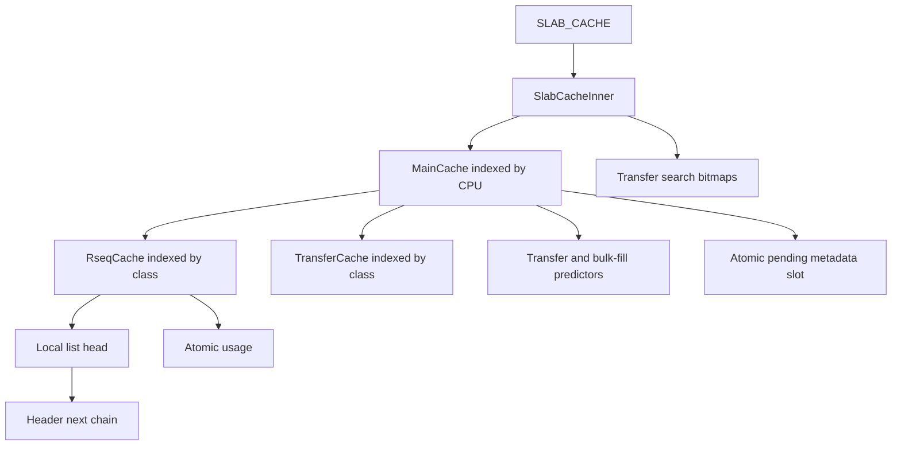

# RSEQ and CPU-local slab caches

This chapter follows the current implementation, not a stable internal ABI.
The overview is in [How the Allocator Works](allocator-design.md); shared exchange is covered in [Transfer caches and reclamation](architecture-transfer.md).
Source references below are repository paths and Rust identifiers, rather than links relative to the generated book.

## Ownership follows execution, not threads

`SLAB_CACHE` in `src/rseq_core/slab_cache.rs` contains one `MainCache` per configured CPU, with entries indexed by size class.
A thread samples libc's RSEQ CPU field and operates on that CPU's list.
A free feeds the CPU executing the free, not necessarily the CPU that allocated the block.
There is no thread-exit operation to drain a thread-private slab heap.

The two interfaces in `src/traits.rs` separate policy from mechanism:

- `GenericCache::{push,push_tailed,pop}` selects a CPU, checks capacity, retries, and falls back to transfer storage.
- `RseqCoreTrait::{push,push_tailed,pop}`, implemented by `RseqCore` in `src/rseq_core/slab_cache/rseq_asm.rs`, performs the short assembly operation.

RSEQ is **not rollback of arbitrary memory writes**.
It redirects execution to an abort handler if execution is interrupted in the registered pre-commit interval.
Correctness depends on preparing private state before one final publication store, then never treating an already committed operation as an abort.

## Cache layout and initialization

`SlabCache::ensure_cache` initializes the subsystem through `Once`.
It obtains the configured processor count with `get_nprocs_conf` (`get_max_cpu` uses 256 if that call returns a nonpositive value), maps `ncpu + 1` cache records, parses NUMA topology, and initializes hint bitmaps and `PENDING_QUEUE`.
This is configured-CPU storage, not a compact table of threads or currently allowed CPUs.
The hot paths use unchecked class indexing and assume valid CPU IDs and completed initialization.

| Type or field | Contents and role |
| --- | --- |
| `RseqCache.list` | `MaybeNull<Header>` local free-list head; changed by RSEQ, not a tagged CAS |
| `RseqCache.usage` | Atomic block count used for capacity policy and debug reporting |
| `MainCache.cache` | One local `RseqCache` per `NUM_SIZE_CLASSES` |
| `MainCache.mail` | One shared `TransferCache` per class |
| `MainCache.transfer_batching` | Advisory policy for initialized-block reuse |
| `MainCache.bulk_fill_batching` | Independent advisory policy for fresh initialization |
| `MainCache.pending_refill` | Atomic pointer to a partially initialized `MetaData` span per class |
| `SlabCacheInner.bitmap` | Class-major nonempty and being-stolen CPU bitmaps for transfer search |

`MainCache` is `repr(C, align(4096))`.
Its asserted size is 4096 bytes normally and 8192 bytes with `experimental-predictive-demand`; `TransferCache` has 64-byte alignment.
These are actual source layout constraints, not a claim that every local class occupies its own cache line.
`RseqCache` itself has no explicit C layout annotation: the assembly derives the usage displacement with `offset_of!`, rather than hardcoding its Rust field offset.
`MaybeNull` is transparent (`src/core_prim/wrappers.rs`).



NUMA initialization tries to bind cache-record ranges with `NumaBind::bind_node` in `src/internals/binder.rs`.
The caller does not turn binding failure into initialization failure.
The cache mapping is zero-filled anonymous memory: null heads, zero counters, and zero predictor state are the initial state.
CPU-local operation does not imply that cache-record pages or user payload pages are guaranteed physically local.

## Headers, classes, and spans

`Header`, `MetaData`, and `Flags` are defined in `src/lib.rs`.
Both header variants keep `Header.next` first; assembly loads or stores the first machine word of a header without a field displacement.
The ordinary header is asserted to be 16 bytes and contains `next`, `flags`, `class`, `magic`, and `life_time`.
`extended-header` makes it 32 bytes, widens `magic`, and changes the remaining field order while preserving `next` at the front.
Both variants have C layout and 16-byte alignment.

A block occupies `align_to(SIZE_CLASSES[class] + Header::SIZE, 16)` bytes.
Its user payload begins one `Header` after the header; `walk_header` and `get_actual_header` implement that conversion in `src/core_prim/wrappers.rs`.
Header overhead and class rounding are distinct from requested payload bytes.

`src/utility.rs` defines 34 payload classes:

```text
16, 32, 48, 64, 80, 96, 128,
160, 192, 256, 320, 384, 512,
768, 1024, 1280, 1536, 1792, 2048, 2560, 3072,
3840, 4096, 8192, 12288, 16384, 24576,
32768, 65536, 131072, 262144, 524288, 1048576, 2097152
```

`match_size_class` maps zero to class zero, uses `SIZE_LUT` through 4096 bytes, `LARGE_SIZE_LUT` through 32768 bytes, and arithmetic for larger power-of-two classes.
Requests above the final class return `None` and leave the slab path.
Aligned APIs may adjust their request before this matching step; the nominal payload alone does not determine every route.

`ITERATIONS` is computed from aligned block size and refill byte targets, with at least one block.
The target is 32 KiB for payloads through 128 bytes and 16 KiB for the other refill categories.
It is a block-initialization/batching limit, not a universal fixed batch count.
`CACHE_HIGH_BLOCKS` separately derives retention limits from `SMALL_CLASS_BYTES`, `MEDIUM_CLASS_BYTES`, and `BIG_CLASS_BYTES` (128 KiB, 96 KiB, and 96 KiB respectively), also retaining at least one block.
`CACHE_LOW_BLOCKS` exists but is not used by the local push/pop policy described here.

`MetaData` describes a backing span: `start`, `end`, an initialization cursor `next`, `node_id`, and atomic `next_page` for pending-queue linkage.
It is not a header for every object, nor a count of live allocations.

## Finding libc's registered RSEQ area

`src/rseq_core/rseq_offsets.rs` declares libc symbols `__rseq_offset` and `__rseq_size` and defines `rseq` with C layout and 32-byte alignment.
Its fields are `cpu_id_start`, `cpu_id`, `rseq_cs`, `flags`, `node_id`, and `mm_cid`.
`get_rseq` reads the thread pointer from `fs:[0]` on x86-64 and adds `__rseq_offset`; its AArch64 branch reads `tpidr_el0` and adds the same exported offset.
The file declares `__rseq_size`, but does not use it to validate the available field range.
RSMalloc relies on libc's registration rather than registering a separate area in this subsystem.

The wrappers sample `cpu_id_start` with `read_volatile`; assembly validates the sampled ID against `cpu_id` **inside** the critical section.
Migration between sampling and entry therefore causes failure instead of allowing publication to an unrelated CPU's local head.
`get_cs_ptr` returns the address of `rseq_cs` for batch push; single push and pop derive field displacements with `offset_of!`.

With `abort-on-rseq-failure`, `get_rseq` aborts when `cpu_id == u32::MAX`.
Without it, this helper does not provide a non-RSEQ fallback for an unavailable registration.
The AArch64 thread-pointer helper is not evidence of an AArch64 local-list implementation: `rseq_asm.rs` currently contains x86-64 instructions.

## Assembly publication and abort boundaries

Each operation emits a 32-byte-aligned descriptor in `.data.rel.ro`:
version and flags are zero, start is label `1`, post-commit offset is `2 - 1`, and abort IP is label `3`.
It installs the descriptor into `rseq_cs` before label `1`.
The protected instruction interval is `[1, 2)`; label `2` immediately follows the committing head store.
The abort handler is preceded by the signature `0x53053053` and sets the result to `-1`.
`RseqResult::FAILED` in `src/result_handling.rs` interprets that value as `usize::MAX`.

| Operation | Work after label `1`, before commit | Commit store | Work at/after label `2` |
| --- | --- | --- | --- |
| `RseqCore::push` | Validate CPU; load old head; write `header.next = old_head` | `list = header` | `lock inc` usage; return success value 1 |
| `RseqCore::push_tailed` | Validate CPU; load old head; write `tail.next = old_head` | `list = batch_head` | `lock add` batch total to usage; return 1 |
| `RseqCore::pop` | Validate CPU; load head; test null; load `head.next` if nonempty | `list = next` | `lock dec` usage; return removed header |

For push, the header or batch is caller-owned until publication.
An abort may leave its linkage pointing at a previously observed head; a retry overwrites that linkage before publishing.
Pop makes no preparatory shared writes: it reads the old head and successor, then commits by replacing the head.
An abort before the store returns the failure sentinel, never a usable removed block.

### The current empty-pop branch matters

The actual empty path in `RseqCore::pop` is `test {res}, {res}` followed by **`jz 5f`**.
It jumps directly to exit label `5`, bypassing both the head store and the usage decrement at label `2`.
The result remains null, so `SlabCache::pop` reports an ordinary empty cache, not an abort.
An interruption while still in `[1, 2)` can instead produce the failure sentinel and cause retry.
Do not describe this path as jumping to label `2`: that would incorrectly imply decrementing usage for an empty list.

### Accounting is outside the commit

All three locked usage updates execute after the protected interval.
If preemption occurs after the head store, the kernel must not redirect that committed operation to label `3`; accounting resumes when normal execution resumes.
This separation keeps the commit store last in the critical section, but creates a window in which list length and `usage` differ.
The counter is atomic; the head and counter are **not one atomic snapshot**.

`rseq_cs` intentionally remains installed on success, empty return, and abort.
The file's lifetime rationale is that descriptors and referenced code have process lifetime; each later operation installs its own descriptor.
There is no per-operation clearing instruction to include in the cost model.

## Wrapper algorithms, high water, and recovery

All wrappers below are in the `GenericCache for SlabCache` implementation in `src/rseq_core/slab_cache.rs`.

1. **Single push:** sample CPU, select class, load usage relaxed. If `usage >= CACHE_HIGH_BLOCKS[class]`, publish to that CPU's normal transfer list. Otherwise attempt RSEQ push. On abort, resample and retry without a fixed retry bound.
2. **Batch push:** perform up to three sampled attempts. If `usage > CACHE_HIGH_BLOCKS[class]`, transfer the entire batch immediately. The current test does not add `batch_size`, so it can admit a batch when usage is at the high-water mark or carry usage beyond it. Otherwise attempt RSEQ batch push. After three failures, call `transfer_push_batch_noninline` using the last sampled CPU.
3. **Pop:** sample CPU and attempt RSEQ pop until the result is not the failure sentinel. Return either a removed header or null. It neither steals nor initializes blocks itself.

Overflow redirects incoming blocks; it does not drain the existing local list down to a low-water mark.
Batch insertion is all-or-transfer rather than splitting to fill the remaining capacity.
Transfer publication can safely target the sampled CPU after migration because it uses shared atomic heads, not another CPU's unprotected local head.
Single push and pop can incur unbounded abort retries; only batch push has this bounded RSEQ fallback.

With `debug`, `ABORTS` accounting is asymmetric: single `push` increments it for each failed RSEQ attempt; `push_tailed` increments it once only after all three attempts fail and transfer fallback completes; `pop` does not count failed attempts.
A batch that succeeds on a later attempt, or takes an early high-water transfer path, records no abort increment for preceding failed attempts.
`RSMallocStats.rseq_aborts` exposes this counter through `get_stats` in `src/frontend/global_alloc.rs`; it is not a total of all RSEQ aborts or retries.

The high-water test is an advisory retention decision made before entry, using a counter whose update follows commit.
It is not an exact admission reservation or a strict concurrent capacity proof.
In quiescent execution, completed balanced operations account for the local list; during interruption, diagnostics and capacity decisions can observe lagging accounting.
`get_rseq_cpu_class_usage_bytes` multiplies a sampled count by aligned block size, and `get_rseq_cpu_usage_bytes` sums separate samples: neither is an instantaneous heap census.

## Allocation, free, and fresh refill

`rs_alloc_inner` in `src/inner/alloc.rs` matches the class, calls `SLAB_CACHE.pop`, and invokes `fill` only on null.
A slab result is optionally ownership-checked, stamped with `MAGIC`, and normally marked `Flags::Allocated` before returning its payload.
`rs_alloc_no_flag` deliberately omits that flag write; `flags` is not simply a live/free Boolean.

`rs_free` in `src/inner/free.rs` handles null, address checks, aligned-pointer recovery, and optional ownership-first validation before its slab branch.
For a header with `MAGIC`, it stamps `life_time` from `CURRENT_STAMP`, changes `magic` to `FREED_MAGIC`, optionally zeroes selected tiny payloads, and calls local `push`.
It does not reset `flags` to `NotAllocated`; flags preserve information relevant to reclamation.
Large-object and foreign-pointer handling are separate paths, not RSEQ abort recovery.

`fill` samples a CPU for transfer policy, tries `SlabCache::try_pop`, updates advisory transfer feedback on success, and otherwise calls `refill`.
`take_one_from_batch` returns the first block, inserts `count - 1` remaining blocks with `push_tailed`, and clears the returned block's `next`.
That insertion resamples the current CPU, so refill state and the final local destination can differ after migration.

Fresh initialization in `src/rseq_core/bulk_fill.rs` proceeds as follows:

1. `bulk_fill` computes aligned block size and atomically removes the CPU/class `pending_refill` pointer with an Acquire swap. This grants that refill exclusive cursor ownership.
2. `init_blocks` initializes at most `max_init` remaining blocks, linking them in address order and writing class, `FREED_MAGIC`, current lifetime stamp, and `Flags::NotAllocated`. It advances `MetaData.next`.
3. Remaining cursor work is republished into an empty pending slot with Release CAS. A collision calls `PENDING_QUEUE.insert`, which can return without retaining the metadata if queue storage is unavailable.
4. Without usable pending work, `alloc_metadata` first tries that queue on the selected node, then requests memory from `PAGE_ALLOCATOR`, records cached VA and radix ownership, and initializes `MetaData`.
5. Span sizing starts with `ITERATIONS[class]` and uses spare space in the enclosing 4096-byte page budget for additional complete blocks. A `None` from `PAGE_ALLOCATOR.alloc` becomes `Err::OutOfMemory`; `bulk_fill` also returns that error when the newly obtained metadata produces zero initialized blocks.

Refill failure is not uniformly a returned error.
After reserving span memory, `alloc_metadata` calls `RADIX.set`; allocating radix metadata can reach `Radix::map_memory` in `src/internals/radix_tree.rs`, whose failed fallback `mmap_anonymous` calls `log_and_abort` rather than returning `Err::OutOfMemory` to `bulk_fill`.

The queue in `src/rseq_core/pending_queue.rs` is node/class-sharded with four 64-byte-aligned lanes, preferred by `cpu_id & PENDING_LANE_MASK`.
Each lane has a pointer-plus-generation `AtomicU128` head and atomic metadata linkage; pop tries the preferred lane then the other lanes.
This queue stores **uninitialized span capacity**, not the initialized free blocks in transfer lists.
`BulkFillQueue::init` silently ignores a failed queue-storage mapping, leaving `nodes` null while `Once::call_once` completes (`src/internals/once.rs`); subsequent initialization calls do not retry that mapping.
In that state, `class_slots` returns `None` and `insert` returns without preserving the extent's metadata reference.
If a pending-slot CAS collides after some blocks were initialized, either collision branch in `bulk_fill` can therefore strand the span's unfinished capacity while still returning the initialized batch successfully.
The backing memory remains reserved, but its remaining initialization cursor is no longer reachable through the slot or queue.
Bulk initialization is linear in blocks touched; retained pending metadata avoids paying that work for every block of a span at once.

## Costs and invariants to carry forward

| Path | Principal work | Tradeoff |
| --- | --- | --- |
| Local nonempty pop | Descriptor installation, CPU check, two dependent list loads, head store, locked decrement | No cache mutex, but still atomic accounting traffic |
| Local single push | Capacity sample, descriptor installation, CPU check, linkage/head stores, locked increment | Cheap reuse, with retained memory and abort retries |
| Local batch push | Constant-size splice plus one locked add | Amortizes insertion; may transfer the entire batch |
| Empty local pop | Descriptor installation, CPU check, null-head branch; no usage update | Refill/search cost moves to `fill` |
| Transfer overflow/refill | Tagged CAS and counters; pop traverses the requested prefix | Contention and pointer chasing replace fresh initialization |
| Fresh refill | Pending ownership, per-block header writes, possibly backend allocation | Larger batches amortize backend work but touch and retain more memory |

Exact ownership transitions are the local committing head stores, transfer-head CAS operations, and pending-pointer removals.
Counters, hints, predictors, and high-water comparisons inform policy; they do not independently establish ownership.
RSEQ removes a mutex from a narrow CPU-local list operation, not from the entire allocator, its backend, or its trimming paths.
No fixed cycle count follows from this source: migration, cache residency, contention, page faults, feature selection, and batch size all affect measured cost.
