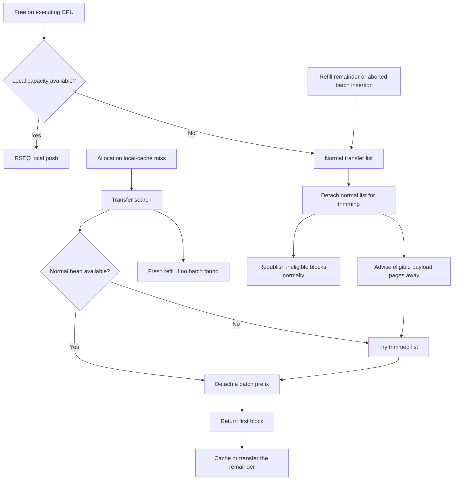

# Transfer caches and reclamation

Transfer caches exchange initialized slab blocks between CPU-local caches.
They receive local-cache overflow and supply allocation refills, preferring reuse before fresh block initialization.
This chapter describes the current source; [RSEQ and CPU-local slab caches](architecture-rseq.md) covers local commits and span initialization, and [How the Allocator Works](allocator-design.md) provides the overview.
Source citations use repository paths and symbol names, not generated-book-relative repository links.

## Two lists per CPU and class

`TransferCache` in `src/rseq_core/slab_cache.rs` is 64-byte aligned and appears in `MainCache.mail[NUM_SIZE_CLASSES]`.
Its lists are shared: producers and consumers need not execute on the CPU whose mailbox they access.
The CPU index identifies a storage/search shard, not exclusive ownership of its contents.

| Field | Meaning |
| --- | --- |
| `list: AtomicU128` | Head of the normal initialized-block list |
| `trimmed: AtomicU128` | Head of the reclaimed-block list |
| `size.normal_blocks` | Atomic accounting for the normal list |
| `size.trimmed_blocks` | Atomic accounting for the trimmed list |
| `trim_lock: SpinLock<()>` | Per-mailbox coordination flag used by trimming and pop |

Both lists contain `Header` nodes with an ordinary `Header.next` pointer.
They are not lists of backing spans: partially initialized `MetaData` spans instead use `pending_refill` and `PENDING_QUEUE` in `src/rseq_core/bulk_fill.rs` and `src/rseq_core/pending_queue.rs`.
Transfer blocks remain virtually addressable when their eligible payload pages are advised away.
Trimming does not unmap their headers or unlink them permanently from reuse.

Normal versus trimmed is a reuse preference, not a separate class or a live/free magic value.
`transfer_pop_batch` begins with the normal head and switches to the trimmed head only when it observes the normal head as null.
A pop selects one list: it does not combine a short normal prefix with trimmed blocks to meet the requested batch size.
New normal blocks can arrive after the switch; the operation does not continually restart to enforce strict global normal-first ordering.

## Head representation and ABA detection

`aba::{Tagging,PackedTag,TAG_SHIFT}` in `src/rseq_core/mod.rs` defines the packed transfer state.
The low 64 bits contain the complete pointer value; the high 64 bits contain a generation.
This does not borrow alignment bits or assume that only a shortened canonical-address prefix is significant.
`untag_ptr` returns both `current_header` and `old_packed`; `tag_ptr(new_pointer, old_packed)` increments the generation with wrapping arithmetic.
Null is also published with an incremented generation, rather than resetting the whole word to zero.

A consumer that observes head `A`, then loses to removals and reinsertions ending at pointer `A` again, must not accept that changed history as its original snapshot.
Comparing the entire pointer-plus-generation word detects it, until generation wrap.
The counter is finite: the source intentionally wraps at the limit of its 64-bit tag.
The pointer preservation and wrap behavior are exercised by `packed_transfer_pointer_preserves_low_address_bits`, `packed_transfer_tag_increments_and_pointer_survives_full_64_bit_address`, and `packed_transfer_tag_does_not_wrap_within_u64_range` in `src/rseq_core/slab_cache.rs`.

The heads use `portable_atomic::AtomicU128`.
The Rust API alone does not prove that every target implements those operations with one hardware instruction or without a fallback; cost claims must account for the selected target and dependency configuration.
A tagged CAS protects the head-state comparison, **not every node access by itself**.
There are no hazard pointers, epochs, or atomic `Header.next` fields in the transfer implementation.
Readers traverse linkage before winning CAS; tags should not be described as a complete proof of safe concurrent node reuse or traversal.

## Publishing a block or a batch

The publication methods are in `src/rseq_core/slab_cache/transfer.rs`.
`transfer_push_single` selects the normal list and counter; `transfer_push_single_trimmed` selects the trimmed equivalents.
Both call `transfer_push_single_to`:

1. Load the packed head with Acquire.
2. Decode pointer and generation; write the caller-owned `header.next` to the observed pointer.
3. Compare-exchange the full word to the header with the next generation, using Release success and Acquire failure ordering.
4. On failure, use the returned head snapshot, rewrite linkage, record optional retry diagnostics, and `spin_loop` before trying again.
5. On success, increment the selected counter; when the old head was null, mark the CPU/class nonempty hint; record optional transfer statistics.

`transfer_push_batch` applies the same loop to an already linked `(start, tail, batch_size)` chain.
Only `tail.next` is rewritten to the observed old head, and one successful CAS publishes the entire chain.
The caller supplies the correct tail and count; publication does not walk or independently validate the batch.
`transfer_push_batch_noninline` is a cold-call boundary used by exhausted local batch retries, not a different publication algorithm.

The successful Release CAS is the publication boundary.
It makes earlier header/link initialization available to a consumer acquiring the head.
The counter increment and hint marking are **after** publication, not part of that boundary.
Neither push path acquires `trim_lock`; publication remains possible while the trimmer is processing detached blocks.

For a batch of `k` already linked blocks, push requires constant linkage work and one successful head CAS plus counter update, rather than `k` publications.
It still may perform arbitrarily many failed CAS attempts under contention.
This amortizes exchange overhead but concentrates multiple producers on the same mailbox head and counter.

## Removing a batch prefix

`SlabCache::transfer_pop_batch(class, cpu_id, batch_size, force)` returns `Option<TransferReturn>`.
Allocation callers request positive sizes; traversal starts at one node, so this is not an API for zero-length removal.

1. Select the normal head/counter and load the head Acquire.
2. Inspect `trim_lock`. With `force == false`, an observed lock returns `None`; forced handling retries or spins as described below.
3. If the selected head is null, switch once from normal to trimmed. If trimmed is also null, repair the hint with `clear_hint` and return `None`.
4. Starting at the observed head, follow `Header.next` until reaching `batch_size` nodes or the end. Remember the prefix tail, successor, and actual count.
5. CAS the packed head to the successor with the next generation, using Acquire ordering on both success and failure.
6. On CAS failure, decode the newly observed head and traverse again; retry accounting and `spin_loop` follow failed attempts.
7. On success, subtract the actual count from the selected counter. Prefetch a nonnull successor with `PreferL1`, otherwise call `clear_hint`. Return the detached prefix description.

| `TransferReturn` field | Interpretation |
| --- | --- |
| `start` | First block of the prefix removed by the successful CAS |
| `end` | Last block included in that prefix |
| `total` | Actual traversed and removed count, not necessarily the requested count |
| `available` | **Previous** selected-list counter value returned by `fetch_sub` |
| `cpu_id` | Supplying mailbox CPU, present only with `predictor-debug` |

The successful CAS is the ownership transition; mere traversal does not reserve a prefix.
Pop does not set `end.next` to null.
A returned batch is bounded by `end` and `total`, not by following links until null: its tail can still point into the remaining published list.
Later insertion overwrites tail linkage, and `take_one_from_batch` in `src/inner/alloc.rs` clears the first block's linkage before returning its payload.

Traversal costs `O(min(requested size, observed list length))` dependent pointer loads per attempt.
A CAS loss discards that attempt's traversal work, making large batches expensive under competing consumers.
There is one successful head CAS and counter subtraction for the batch, not one per returned object.
Acquire removal consumes published linkage; it is not a Release publication of rewritten nodes.

## Inventory is a sample, not the list's truth

The list head and its counter are independent atomic objects.
A push publishes before adding its count; a pop removes before subtracting its count.
Consequently, another pop can observe a newly published list before its producer updates accounting.
Without trimming, a counter may temporarily underflow using unsigned atomic arithmetic; balanced push/pop updates can restore accounting after operations complete.
Trimming introduces a separate, potentially persistent discrepancy: `trim_small` in `src/rseq_core/slab_cache/reclaim.rs` loads `current_size` **before** its detach CAS and subtracts that sample after success, not the actual detached chain count.
For example, a producer can publish a block and pause before incrementing the counter. The trimmer can then sample zero, detach that block, subtract zero, and republish it normally with an increment. When the original producer resumes and increments, the list has one block but its counter is two, even after both operations finish.
Republishing to the trimmed list can likewise leave the original producer's late increment in the now-empty normal counter.
Quiescence therefore does not guarantee recovery from trim-induced drift, and later `available` samples can remain inaccurate.
Do not assume exact list length from a count, or derive ownership from that count.

`available` is not the number remaining after this pop, not the combined inventory of both lists, and not a stable count of all CPUs' available blocks.
It is advisory feedback for `AdaptiveBatching`, as explicitly documented on `TransferReturn` in `src/rseq_core/slab_cache.rs`.
`AtomicOrdering::TransferFetchOp` maps to Relaxed on x86-64 and AcqRel on AArch64; `TransferFetchLoad` maps to Relaxed and Acquire respectively (`src/internals/atomics/mod.rs`).
Stronger counter ordering alone would not make the head and count one transactional snapshot.

## Hints and search order

`Bitmap` in `src/rseq_core/slab_cache.rs` holds class-major arrays of atomic 64-bit words.
`bitmap::cpu_word_bit` in `src/rseq_core/mod.rs` splits a CPU index into a word and bit.
The nonempty bit summarizes **either** transfer list; it says nothing about the local RSEQ list.
Bitmap reads and bit RMWs use Relaxed ordering.

A push marks nonempty when it changes a null selected head to nonnull.
`clear_hint` first clears the bit, then Acquire-loads both list heads and restores the bit if either is nonnull.
That recheck reduces missed publications during clearing, but the bit remains advisory and can be stale while operations overlap.
A set bit can lead to a failed pop; a temporarily absent bit can cause reuse to be skipped and fresh refill to occur.
Head CAS, not bitmap state, decides whether blocks were obtained.

Search in `try_pop`, `pop_slow`, and `first_nonempty_cpu_in_range` is:

1. If the requesting CPU's nonempty hint is set, try its mailbox with `force == false`.
2. Search other CPUs in the requesting node's inclusive CPU range, or all configured CPUs when NUMA mode is off.
3. For each bitmap word, make a nonforced pass and then a forced pass, reloading its bits for each pass. Mask the range endpoints, visit set bits in increasing CPU order, and skip the requesting CPU.
4. Use the being-stolen hint to discourage competing thieves in the nonforced pass. The forced pass can attempt the victim despite an existing mark.
5. After any victim attempt, clear its being-stolen bit. Return on the first successful batch.
6. In NUMA mode, `slowest_numa_steal_path` rotates through other range indices modulo `nranges`; failure eventually returns `None` to fresh refill.

This is not random victim selection, a global balancing operation, or a complete scan of unhinted heads.
The forced pass occurs per word, not after a nonforced sweep over the entire range.
The requesting CPU is skipped in range search even if its initial local-mailbox attempt failed.

`cpu_try_marking` first checks the bit, then performs `fetch_or`, and does not test the previous value returned by the RMW.
Two thieves can both see a clear bit and both return true.
Thus the being-stolen bitmap is **contention guidance, not an exclusive lock**; clearing it is likewise not a release of uniquely owned list state.
The packed head CAS arbitrates actual prefix removal.

## NUMA preference is approximate

`parse_numa_topology` in `src/internals/numa_parser.rs` reads online node IDs and node CPU lists from sysfs.
It builds `cpu_to_node` and node-ID-indexed `cpu_ranges`; `nranges` includes slots through the maximum node ID, whereas `nnodes` counts online nodes.
Missing or invalid CPU mappings fall back to node zero; absent node sysfs information has a single-node topology fallback.
`SlabCache::ensure_cache` enables NUMA mode only when parsed topology reports more than one node.

`populate_cpu_ranges` records each node's minimum and maximum CPU ID.
That interval can enclose CPUs belonging to another node when numbering is interleaved; transfer search does not revalidate each victim's `cpu_to_node` value.
Thus “local node first” means **local node's bounding CPU interval first**, not a guarantee that every first-stage victim belongs to that node.
Empty range slots are represented by start greater than end.

`node_for_cpu` supplies a node for fresh refill, and cache-record binding attempts use `NumaBind` in `src/internals/binder.rs`.
Neither search order nor a mapping policy proves physical payload locality.
Cross-CPU frees, prior remote reuse, first touch, and kernel memory policy can all affect placement.
Remote stealing trades potential NUMA/cache latency for avoiding backend allocation and additional retained capacity.

## Refill feedback and batch tradeoffs

`fill` in `src/inner/alloc.rs` reads the requesting CPU's transfer predictor, requests a batch, and updates that predictor after a successful transfer pop.
It then returns one object and pushes the remainder through the current CPU's local-cache policy.
If search returns `None`, `refill` initializes blocks using the independent bulk-fill predictor.
Predictor changes do not occur on every local cache hit.

Default `AdaptiveBatching::update_transfer` in `src/core_prim/predictor.rs` targets one quarter of sampled `available`, clamped to `[1, ITERATIONS[class]]`.
It moves one quarter of the gap toward that target, with a minimum movement of one.
Updates use a best-effort weak relaxed CAS, so competing or spurious failures can discard policy updates without retry.
With `experimental-predictive-demand`, the target also incorporates a completion-based demand forecast derived from delivered blocks and depletion time. See [the demand model](architecture-refill.md#experimental-demand-completion-based-bounded-trend) for its bounded trend, caps, and finish-time gate.
With `confidence-predictor`, `transfer_batch` and `update_transfer_feedback` instead use requested/obtained counts, supply, and confidence history; the maximum is `PREDICTOR_BATCHING[class]`, defined as the high-water count plus one.
That extra block permits returning one object before inserting the remainder into an empty cache, subject to the advisory admission test.

Larger reuse batches amortize search, CAS, and refill calls, but increase traversal, local retention, and the chance of whole-batch overflow back to transfer.
Smaller batches spread supply among consumers and reduce immediate retention, at the cost of more exchanges.
Approximate inventory can produce imperfect policy decisions; it must not change the exact count of blocks a successful CAS removed.

## Trimming: detachment, partitioning, and republishing

`trim_small` and `release_memory` are in `src/rseq_core/slab_cache/reclaim.rs`.
The trimmer visits transfer mailboxes, **not** CPU-local RSEQ heads or pending initialization spans.
It returns immediately when both cached-VA threshold checks are below their limits, or when `GLOBAL_TRIM_LOCK.try_lock` fails.
The global lock serializes this trim routine, including its mutable `TRIM_SMOOTHING` updates.

For every configured CPU and class at or above `get_size_4096_class`, it:

1. Acquires `trim_lock` and retains its RAII guard through detachment, partitioning, and retained-block publication. An empty-list exit drops the guard automatically, after the optional empty-list smoothing adjustment.
2. Acquire-loads the normal packed head, samples `normal_blocks` before each detach CAS attempt, and CASes the head to tagged null. On success, subtracts that pre-CAS sample rather than the actual chain count. The detached chain drives traversal; publication-before-increment can make the sample incomplete and leave persistent counter drift after republishing.
3. Partitions the detached chain. A block goes to trim candidates only if its saturating age exceeds `TRIM_SMOOTHING[class].time(100)` and `flags == Flags::Allocated`; otherwise it is retained normally.
4. Republishes retained blocks in batches at `ITERATIONS[class] + ITERATIONS[class] / 2`, plus any final remainder, then explicitly drops the per-mailbox guard. It updates per-class age smoothing from nonzero lifetime samples before processing trim candidates.
5. Processes the private candidate chain after the guard is dropped. Successful memory advice changes `flags` to `Reclaimed` and publishes to the trimmed list; unsuccessful or budget-skipped candidates go back to the normal list. Both receive the sampled lifetime stamp.

After the mailbox scan, the routine updates the global average lifetime statistic from the per-class estimates.

The partition reverses linkage as it builds its temporary chains; transfer storage does not promise FIFO or address-order reuse.
`Flags::Allocated` means the normal allocation path previously marked the block, not that the detached free block is still user-owned.
Free changes magic and lifetime but preserves flags (`rs_free` in `src/inner/free.rs`); allocation normally restores `Allocated` on a reclaimed block (`rs_alloc_inner` in `src/inner/alloc.rs`).
Fresh untouched blocks marked `NotAllocated` do not satisfy this candidate test.
The `trim-aggressively` branch omits the empty-list smoothing adjustment; the age-and-flag candidate condition still exists in the current code.

`release_memory` uses 4096-byte page boundaries, rounding payload start up and payload end down.
Only complete payload pages are advised; the header and boundary fragments remain accessible.
No complete page means no release attempt.
It uses `Advice::LinuxDontNeed`, or `Advice::LinuxFree` with `lazy-page-trim`, and reports success according to `madvise`.
Returned `total_trimmed` adds the class payload size for each success, not the exact rounded advice length or measured RSS reduction.
A nonzero `requested_size` gates later advice once that accumulated total reaches it; the routine still republishes remaining candidates and can overshoot by a block.
Virtual storage remains reserved, and reuse can incur page faults or renewed physical allocation.

## Trim-lock coordination

`trim_lock` is not acquired by ordinary transfer pops; they only Acquire-load its Boolean state through `SpinLock::get_lock` (`src/internals/lock.rs`).
A nonforced pop that observes it set returns `None`.
A forced pop does not simply ignore it: with a nonnull sampled head it loops back to the lock check; with a null sampled head it reloads/spins until a head appears or the lock becomes clear.
Forced paths can therefore wait for trimming rather than providing bounded-latency failure.

The trim flag controls pop-side waiting while trimming detaches and partitions the normal chain.
The tagged head CAS determines whether a pop removes its observed prefix; on CAS failure, the pop retries with the newly observed head.
The being-stolen bit separately discourages competing searches; it is not an exclusive acquisition.

## Cost and correctness summary

| Mechanism | Exact boundary or observable fact | Approximation or cost |
| --- | --- | --- |
| Tagged head | Successful CAS publishes/removes a chosen chain or prefix | Generation wraps; retries and atomic implementation affect latency |
| Batch traversal | `total` counts the winning observed prefix | Dependent loads are repeated on CAS failure; tail need not be null |
| Inventory counters | Atomic arithmetic returns a definite counter sample | Not synchronized transactionally with list length; trim-induced drift can persist after quiescence |
| Nonempty bitmap | A search hint for normal or trimmed storage | Staleness can waste searches or miss reuse |
| Being-stolen bitmap | Relaxed marking discourages some competitors | Load-then-mark is not exclusive acquisition |
| NUMA search | Deterministic bounding-range-first search | Not strict node membership or physical-locality proof |
| Trimming | Advice ranges preserve headers; processed blocks are republished | Scanning, advice, and forced waiting add cost; reported bytes are not RSS reduction |

Transfer reuse avoids initializing new objects, but replaces that work with shared-head contention, pointer traversal, accounting traffic, and possible remote access.
Trimming exchanges future reuse latency for potential resident-memory relief; it is not a request to empty every cache.
Measure these costs under the application's allocation/free topology rather than inferring universal scalability or fixed timing from the absence of a local-cache mutex.
